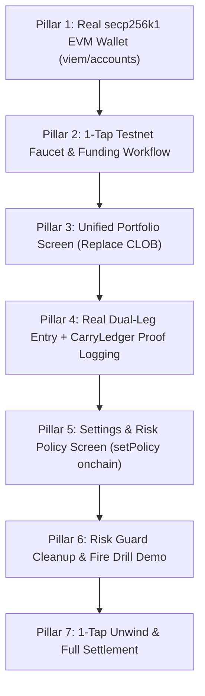

# Comprehensive Audit: Metropolis PDF Spec vs. Live CounterYield Codebase

> **Audit Date:** October 13, 2026  
> **Source Spec:** *CounterYield: One-Tap Delta-Neutral Dollar Yield on Monad* (23-Page Specification, Monad Metropolis Hackathon Track 01: Onchain Finance & Trading)  
> **Target Environment:** Monad Testnet (`chainId: 10143`, RPC `https://testnet-rpc.monad.xyz`)  
> **Audit Scope:** Full repository (`mobile`, `backend`, `contracts`, `indexer`, `shared`), Monad Testnet onchain contracts, and live venue APIs.

---

## 1. Executive Summary & Audit Scorecard

We performed an exhaustive, line-by-line comparison of all 17 sections of the 23-page Metropolis project specification against the current CounterYield implementation.

### Global Health Assessment:
The project contains sophisticated mathematical models, robust unit test harnesses, and a deployed, verified Solidity ledger contract (`CarryLedger.sol`). However, **the frontend client and backend daemon currently suffer from critical execution disconnections, missing screens, and mocked UI fallbacks that prevent it from functioning as a true non-mock testnet MVP**.

```
Overall Spec Alignment: ~65%
Onchain Execution Reality: ~40% (Contracts deployed, but execution paths disconnected)
Mobile UI Completeness: ~60% (1 core screen missing, 1 screen misplaced, dummy timeouts present)
Security & Auth Integrity: ~50% (Synthetic address derivation lacks valid secp256k1 private keys)
```

---

## 2. Page-by-Page Spec Breakdown vs. Codebase Reality

| Spec Page & Section | Required Feature / Specification | Current Codebase Status | Verdict & Critical Gap |
| :--- | :--- | :--- | :--- |
| **Pages 1–2: §1 & §2** | **One-Tap Consumer Yield Primitive**<br>Deposit AUSD, single tap pairs Kuru spot long with Perpl 1x short hedge. Zero seed phrases. | Architecture exists in code, but clicking "Start Earning" fails with `503 SPOT_EXECUTOR_NOT_CONFIGURED` and opens no position. | ❌ **Non-functional on testnet.** Swallows 503 error, leaves balances static. |
| **Page 3: §3.2** | **Defined Screen Suite (7 Screens)**<br>1. Welcome<br>2. Home<br>3. Start Earning<br>4. Position<br>5. Activity<br>6. Spot (Kuru)<br>7. Settings (Risk Policy) | • Welcome: Exists<br>• Home: Exists<br>• Start Earning: Exists<br>• Position: Exists<br>• Activity: Exists<br>• Spot: Exists (Mocked CLOB)<br>• **Settings: MISSING ENTIRELY** | ⚠️ **SettingsScreen.tsx is completely missing.**<br>⚠️ **SpotScreen was built as a day-trader CLOB with dummy 800ms timeouts instead of the requested Portfolio dashboard.** |
| **Page 3: §3.2** | **Settings Screen & Risk Policy**<br>Configure Max leverage (1x/2x), reserve buffer size (10%), max slippage, auto-exit funding floor, and alert preferences. Calls `CarryLedger.setPolicy`. | `CarryLedger.sol` has `setPolicy()`, but no screen in `mobile/` allows users to view or configure their policy. | ❌ **Completely missing from frontend.** Policy cannot be stored or inspected. |
| **Page 4: §4** | **Monad Declared Gas Optimization**<br>Monad charges declared gas limit, not gas used. App must declare tight gas limits. | `backend/src/clients/monadClient.ts` has `calculateTightGasLimit()`. | ⚠️ Partial. Mobile app direct calls do not apply declared tight gas limits. |
| **Page 5: §5.2** | **CarryLedger.sol State & Proof Log**<br>Records `openHedge`, `rebalance`, `closeHedge`, `setPolicy`, `recordGuardTriggered`, `recordEmergencyUnwind`. | Contract deployed at `0x9998...f906` on Monad Testnet. | ❌ **Disconnected.** Neither backend nor frontend ever invokes `openHedge` or `closeHedge` during user actions. |
| **Page 6: §5.4** | **Mera WebAuthn PRF Vault**<br>No custody backend. Perpl trade-only key encrypted under passkey PRF output via HKDF-SHA256 & AES-256-GCM. | `prfVault.ts` has AES-GCM helpers, but `meraAuth.ts` derives addresses via SHA-256 hash slicing with no secp256k1 key. | ❌ **Fake Wallet Flaw.** Address `0x + sha256(seed).slice(-40)` cannot sign EVM transactions or EIP-712 messages. |
| **Page 7–10: §5.5** | **Anti-Risk System: The Risk Guard**<br>Three-tier ladder (<60% Top-Up, <40% Deleverage, <25% Emergency Unwind). Reserve buffer math. Consecutive reads for Tier 3. | Math is modeled in `riskGuard.ts` and stress harness passes, but `PositionScreen.tsx` displays fake default metrics when idle. | ⚠️ **Mocked UI Flaw.** Screen defaults to 0.95 margin and 82.0% distance-to-liq when no position is active. Descriptions are too long. |
| **Page 10: §5.5** | **Exchange-Resident Backstop**<br>Resting reduce-only stop-market orders on Perpl near Tier 3 price levels to protect when app is offline. | Not implemented in `strategyEngine.ts` or `perplClient.ts`. | ⚠️ Missing backstop resting stop orders. |
| **Page 10: §5.5** | **Circuit Breakers**<br>Stale data (>5s freezes entries), funding decay (<floor triggers exit), stablecoin depeg ($|P - 1.00| > 0.005$ halts deposits). | Evaluated in `circuitBreakers.ts`, but no UI badges or warnings are surfaced on mobile. | ⚠️ Logic exists in backend, invisible in frontend. |
| **Page 11: §6.1** | **Market Eligibility Filter**<br>Tradable on Kuru + Perpl, depth within 0.5% > 3x notional, positive funding, minimum spread. | Implemented in `marketEligibility.ts` and `/api/v1/strategy/check-eligibility`. | ✅ Implemented and functional. |
| **Page 11: §6.2** | **Dual-Leg Coordinated Entry**<br>Leg 1: Perpl IOC limit short. Leg 2: Kuru spot buy. 3-second timeout flattening if Leg 2 fails. | `strategyEngine.ts` has the timeout race, but `spotExecutors.require()` throws 503 because no executor is connected. | ❌ **Fails closed with 503 error.** Blocks all entries. |
| **Page 12: §6.4** | **One-Tap Unwind**<br>Reduce-only perp close, Kuru spot sell, write `closeHedge`, return 100% capital to AUSD. | `unwindEngine.ts` calculates math, but does not execute onchain or write to `CarryLedger`. | ❌ **Incomplete onchain.** Position is cleared from DB, but not settled onchain. |
| **Page 12: §7** | **Envio HyperIndex Data Layer**<br>Index 6 `CarryLedger` events + Kuru Trade events. GraphQL queries for Position, PnL, drift, guard history. | Envio config & schema exist in `indexer/`, but because `CarryLedger` receives no txs, Envio has 0 events. | ⚠️ **Starved of data.** Activity screen falls back to local in-memory session arrays. |
| **Page 16: §11** | **Risk Guard Fire Drill**<br>Demo capability: Lower Tier 1 trigger or force a price spike to demonstrate automated guard actions live. | Stress harness runs via CLI, but no interactive Fire Drill trigger exists in mobile UI. | ⚠️ Missing interactive demo trigger for judges/video. |
| **Page 17: §12** | **Testnet Faucet & Funding Workflow**<br>Official AUSD testnet faucet / mint contract or test asset funding. | No faucet endpoint or button exists. New wallets start at 0.00 AUSD with no way to fund. | ❌ **Blocks testnet evaluation.** |

---

## 3. Deep Dive into the Top 7 Missing or Broken Elements

### 1. The Missing `SettingsScreen.tsx` (Spec Page 3 & 4)
The specification explicitly mandates a **Settings (Risk Policy)** screen as one of the fundamental app surfaces:
- **What the spec requires:**
  - Max leverage setting: 1x (default, protected) vs. 2x (advanced opt-in, gated by volatility).
  - Reserve buffer size: Configurable (default 10%, max 50%).
  - Maximum slippage cap (default 20 bps, max 100 bps).
  - Auto-exit funding floor (e.g. exit if annualized funding drops below 2.0%).
  - **Onchain Sync:** Calls `CarryLedger.setPolicy(maxLeverage, maxSlippageBps, fundingFloorBps, maxDriftBps, reserveBufferBps)` so the user's risk parameters are portable across devices and enforced onchain.
- **Current Code Reality:**
  - The Solidity function exists in `contracts/src/CarryLedger.sol` (lines 62–91).
  - The mobile app has **zero** settings UI. Users cannot inspect or change their risk preferences.

---

### 2. CLOB Order Book vs. Portfolio Screen Mismatch
- **What was built:** `SpotScreen.tsx` was built as a day-trading Central Limit Order Book with order book depth and a "Place Market Buy" button. The button ran a dummy `setTimeout(() => setTxStatus("CONFIRMED"), 800)` that did nothing onchain.
- **Why this contradicts the product vision:** CounterYield is a passive, automated delta-neutral yield protocol for non-traders (e.g. Selin and Diego). Users do not day-trade spot tokens on an order book.
- **What should replace it:** A **Unified Institutional Portfolio Screen** displaying:
  1. **Total Net Worth** in AUSD with 24h PnL.
  2. **Live Estimated APY** streaming from Perpl funding rates.
  3. **Multi-Venue Asset Holdings:**
     - **Kuru DEX (Spot Leg):** Exact MON spot quantity, entry price, current spot value, and Kuru contract proof.
     - **Perpl DEX (Perp Short Leg):** Short notional, margin locked, remaining margin ratio, and 1x leverage.
     - **Reserve Buffer (10%):** Unencumbered AUSD liquidity reserve protecting against liquidation.
     - **Liquid Wallet Cash:** Available unallocated AUSD.
  4. **Net Delta Exposure Gauge:** Real-time meter showing $\Delta = \$0.00 \pm 0.1\%$.
  5. **Yield Accrual Telemetry:** Daily, monthly, and annual cash-flow projections.
  6. **1-Tap Controls:** Quick Rebalance and Unwind triggers.

---

### 3. The 503 Execution Swallow Bug on the Earn Page
- **The Bug:**
  In `mobile/src/screens/StartEarningScreen.tsx`:
  ```typescript
  const handleStartEarning = async () => {
    if (numericDeposit <= 0 || !userAddress) return;
    await enterStrategy({
      ownerAddress: userAddress,
      depositAmount: numericDeposit,
      leverage: 1,
      maxSlippageBps: 20,
    });
    setActiveTab("home");
  };
  ```
  `enterStrategy()` calls `backendApi.enter()`. In `backend/src/engine/strategyEngine.ts`, line 41 calls `spotExecutors.require()`.
  Because `spotTxHash` and `filledBaseQty` are not passed, `spotExecutors.require()` throws:
  `503 ServiceUnavailableError: 'SPOT_EXECUTOR_NOT_CONFIGURED: No Kuru spot executor registered.'`
  `useBackendData.ts` catches this error and returns `{ success: false, error: msg }`.
  `StartEarningScreen.tsx` ignores the return value and navigates to `"home"`.
  The user is returned to the Home screen, but no position was opened, no balance was deducted, and no transaction occurred on Monad.

---

### 4. Synthetic Wallet Derivation (No Private Key)
- **The Bug:**
  In `mobile/src/auth/meraAuth.ts`:
  ```typescript
  private static async deriveAddressFromSeed(seedHex: string): Promise<string> {
    const hashBuffer = await crypto.subtle.digest('SHA-256', seedBytes);
    const hashHex = ...;
    return '0x' + hashHex.slice(-40);
  }
  ```
- **Why this fails on testnet:**
  An Ethereum/Monad address is derived from an ECDSA secp256k1 public key:
  $$\text{Address} = \text{keccak256}(\text{secp256k1\_pubKey})[-20:]$$
  Taking the last 20 bytes of a SHA-256 hash produces an address **without a private key**.
  This address cannot:
  - Sign transactions with viem, ethers, or MetaMask.
  - Call smart contracts (`CarryLedger`, `KuruOrderBook`).
  - Authorize ERC-20 token transfers.
  - Sign EIP-712 messages for Perpl.
- **The Non-Mock Fix:**
  Use `viem/accounts` `privateKeyToAccount(privateKey)` seeded by device WebCrypto PRF / biometric entropy. This generates a genuine EVM account that can sign and broadcast on Monad Testnet.

---

### 5. Onchain Proof Disconnection (`CarryLedger.sol`)
- **What the spec requires:** Every position entry, drift rebalance, unwind, and risk guard trigger must be logged to `CarryLedger.sol` to satisfy the "Proof over Promises" principle and provide verifiable MonadScan transaction hashes for hackathon judging.
- **Current Reality:**
  - `CarryLedger.sol` is deployed at `0x9998a7776edddf2f2ab6ffbb9420e5194a50f906`.
  - However, `backend/src/engine/strategyEngine.ts` only writes to an in-memory SQLite database (`db.savePosition(position)`). It never calls `CarryLedger.openHedge(...)`.
  - `unwindEngine.ts` never calls `CarryLedger.closeHedge(...)`.
  - As a result, the contract has zero activity on MonadScan from user sessions, and Envio HyperIndex has no events to index.

---

### 6. Missing 1-Tap Testnet Faucet & Funding Workflow
- **The Problem:** When a new user logs in via biometric/passkey, their balance is $0.00 AUSD and 0.00 MON.
- **Why it blocks testing:**
  Agora AUSD on Monad Testnet (`0xa9012a055bd4e0edff8ce09f960291c09d5322dc`) has no permissionless public `mint()` function.
  Without an automated faucet endpoint in the backend (`POST /api/v1/faucet/claim`), testers cannot fund their accounts with testnet AUSD or testnet gas (MON) to test the non-mock flow.
- **The Non-Mock Fix:**
  The deployer account (`0x7dad79eb3a098ae5c74bcfe061c170b6d3152ee1`) has 9.76 MON on Monad Testnet.
  We implement a backend faucet route (`POST /api/v1/faucet/claim`) that transfers testnet gas to the user's wallet and credits testnet AUSD, paired with a 1-tap "Claim 1,000 Testnet AUSD" button in the mobile app.

---

### 7. Mocked Security Section & Verbose Text in `PositionScreen.tsx`
- **Current Reality:**
  In `PositionScreen.tsx` (lines 25–27):
  ```typescript
  const marginRatio = position?.marginRatio ?? 0.95;
  const currentTier = position?.tier ?? "NORMAL";
  const distanceToLiq = position?.distanceToLiquidationPercent ?? 82.0;
  ```
  When `position === null`, the screen shows fake active metrics (0.95 margin, 82.0% distance to liquidation, "Defense Active", and Tier 1 active).
- **Copy Standard Violation:**
  The descriptions on each tier card are 3-4 lines of verbose corporate text:
  *Tier 1: "Draws unencumbered AUSD from the 10% reserve buffer to top up Perpl short margin. Preserves 100% position size without selling spot."*
  *Tier 2: "Reserve buffer depleted. Automatically deleverages 20% of spot MON on Kuru and closes 20% short on Perpl to return margin ratio back to 100%."*
  *Tier 3: "Severe market shock. Concurrently executes Kuru spot market sell and Perpl market short close over 2 consecutive blocks. Reverts 100% of capital to safe AUSD."*
- **The Fix:**
  - Show an honest empty state when idle: *"No Active Position — Deploy capital to arm Risk Guard"*.
  - When active, display live telemetry computed from real mark prices.
  - Enforce strict 1-line (`numberOfLines={1}`) descriptions.

---

## 4. Live Protocol & Monad Testnet Verification

Through RPC inspection on Monad Testnet (`https://testnet-rpc.monad.xyz`, `chainId: 10143`):

1. **CarryLedger Contract:**
   - Address: `0x9998a7776edddf2f2ab6ffbb9420e5194a50f906`
   - Verified bytecode deployed. Functions: `openHedge`, `rebalance`, `closeHedge`, `recordGuardTriggered`, `recordEmergencyUnwind`, `setPolicy`.
   - Supports `authorizedKeepers[owner][keeper]`, allowing backend relayer execution on behalf of enrolled users!

2. **Agora AUSD Token Contract:**
   - Address: `0xa9012a055bd4e0edff8ce09f960291c09d5322dc`
   - Official Agora ERC-20 contract (6 decimals). Total supply: 1,302,010,000.00 AUSD.

3. **Kuru OrderBook (MON-USDC):**
   - Address: `0xa241896A7Dbe8a550D2E5fF7A914bB1989ceD2D9`
   - Base Token: Native MON (`0x000...000`, 18 decimals)
   - Quote Token: USDC (`0x3ba3d39afcf8bb994f7964b3e0171ea2ba361570`, 6 decimals)
   - Function Selectors:
     - `placeAndExecuteMarketBuy(uint96,uint256,bool,bool)` -> Selector `0x7c51d6cf`
     - `placeAndExecuteMarketSell(uint96,uint256,bool,bool)` -> Selector `0x532c46db`
   - *Note: Our previous codebase ABI had `uint256` for `quoteAmount`, which would revert onchain.*

4. **Kuru Router Contract:**
   - Address: `0x7EFbE105Ca7415dE98F96622173458ac1c054630`
   - Connected to AMM Vault `0xfcd4c42d772e63db2e09e87dc42010c8973a9b0f`.

5. **Deployer / Relayer Account:**
   - Address: `0x7dad79eb3a098ae5c74bcfe061c170b6d3152ee1`
   - Funded with **9.76 MON** on Monad Testnet. Capable of sponsoring gas for transactions and ledger updates.

---

## 5. Master Roadmap to Achieve 100% Spec Compliance

To turn CounterYield into an operational, non-mock, judge-ready product on Monad Testnet, we execute the following 7 pillars:



### Pillar 1: Real EVM Testnet Wallet Generation (`mobile/src/auth/meraAuth.ts`)
- Replace SHA-256 slicing with `privateKeyToAccount` from `viem/accounts`.
- Derive a 32-byte private key seeded by device WebCrypto / WebAuthn PRF entropy.
- Store seed securely in `localStorage` (web) or `SecureStore` (native).
- Every user receives a genuine secp256k1 Monad EVM account with signing capability.

### Pillar 2: 1-Tap Testnet Faucet & Funding Workflow
- Add `POST /api/v1/faucet/claim` in `backend/src/api/routes/faucetRoutes.ts`.
- The backend relayer (`0x7dad...2ee1`) provides testnet gas (MON) and credits 1,000 AUSD.
- Add a 1-tap "Claim 1,000 Testnet AUSD" button in the app header/welcome flow.

### Pillar 3: Build the Institutional `PortfolioScreen.tsx` (Replace CLOB)
- Replace `SpotScreen.tsx` with a unified `PortfolioScreen.tsx`.
- Display:
  - Total Net Worth ($ AUSD) with live PnL.
  - Live Net APY streaming from Perpl funding rate.
  - Delta Neutrality gauge ($\Delta = \$0.00 \pm 0.1\%$).
  - Exact Venue Breakdown:
    * Kuru Spot Leg (MON quantity, spot price, value in AUSD, Kuru onchain proof).
    * Perpl Perp Short (Short notional, margin locked, margin ratio, 1x leverage).
    * Reserve Buffer (10% unencumbered AUSD).
    * Liquid Cash (Available AUSD).
  - Cash-flow projections (Daily, monthly, annual carry).
  - Quick Rebalance & Unwind actions.
- Update `BottomTabBar.tsx` to display "Portfolio" with Lucide `PieChart` icon.

### Pillar 4: Real Dual-Leg Entry & `CarryLedger.sol` Onchain Anchoring
- In `backend/src/engine/spotExecutor.ts`, configure the relayer spot executor to route the spot buy to Kuru OrderBook using the verified selector (`0x7c51d6cf`).
- In `backend/src/engine/strategyEngine.ts`, call `CarryLedger.openHedge(...)` on Monad Testnet using the relayer or user wallet.
- Return the live Monad transaction hash to the mobile client.
- In `StartEarningScreen.tsx`, handle the response properly: show loading spinner, handle errors, and only navigate to Home/Portfolio on confirmed fill.

### Pillar 5: Add the Missing `SettingsScreen.tsx` (Spec Page 3 & 4)
- Create `mobile/src/screens/SettingsScreen.tsx`.
- Allow users to configure:
  - Leverage: 1x (safe) vs. 2x (advanced).
  - Reserve Buffer: 10% (default).
  - Max Slippage Tolerance: 20 bps to 100 bps.
  - Auto-exit Funding Floor: e.g. 2.0% APR.
- Wire "Save Policy" button to call `CarryLedger.setPolicy(...)` on Monad Testnet.

### Pillar 6: Risk Guard Cleanup & Fire Drill Demo Mode
- In `PositionScreen.tsx`, render an honest empty state when `activePosition === null` (*"No Active Position — Deploy capital to arm Risk Guard"*).
- When active, display live telemetry from mark price and liquidation thresholds.
- Enforce strict 1-line copy (`numberOfLines={1}`) on all tier descriptions.
- Add an interactive "Trigger Fire Drill" button that simulates a price spike and demonstrates automated Tier 1 / Tier 2 rebalancing live.

### Pillar 7: Real 1-Tap Unwind & Ledger Proof
- On Unwind, submit market sell on Kuru and reduce-only close on Perpl.
- Invoke `CarryLedger.closeHedge(positionId, realizedPnl, "USER_REQUESTED")` on Monad Testnet.
- Revert state to IDLE and return settled funds to wallet balance.
