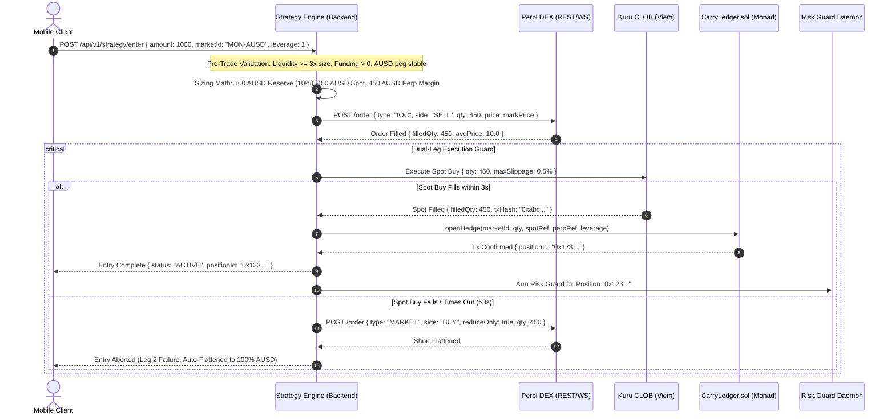

# Counter Yield: 5-Phase Master Architecture & Implementation Plan
**One-Tap Delta-Neutral Dollar Yield on Monad (Testnet)**  
*Monad Metropolis Hackathon — Track 01: Onchain Finance & Trading*

---

## Executive Summary & Deep Dive Analysis

Counter Yield is a mobile-native, non-custodial decentralized finance primitive that automates institutional basis trading (funding-rate cash-and-carry arbitrage) on Monad. By pairing a spot purchase on **Kuru** (an onchain Central Limit Order Book) with an equal-sized 1x short position on **Perpl** (an onchain perpetual DEX), the protocol creates a synthetic dollar exposure ($\Delta \approx 0$) that earns the continuous funding rate paid by perpetual longs.

This document establishes the exhaustive architectural blueprint and phase-by-phase execution plan for the Counter Yield protocol on **Monad Testnet** (`chainId: 10143`). It strictly adheres to production full-stack standards, data-first state-driven architecture, and zero-mockup integration requirements.

```mermaid
graph TD
    subgraph Client ["Client Layer (Expo / React Native)"]
        Auth["Mera WebAuthn PRF<br/>(Hardware Isolated)"]
        UI["High-End Fintech UI<br/>(Net Delta, Live APR, Ladder)"]
        Store["State Engine / TanStack Query"]
    end

    subgraph Backend ["Backend & Strategy Service"]
        Router["Dual-Leg Execution Router<br/>(Perpl IOC -> Kuru Spot)"]
        RiskGuard["3-Tier Risk Guard Engine<br/>(Top-Up, Deleverage, Unwind)"]
        Telemetry["Financial Telemetry Service<br/>(Real-Time Drift & Mark TWAP)"]
        WSFeed["Real-Time WebSocket Gateway"]
    end

    subgraph Venues ["Monad Testnet Protocol Venues (10143)"]
        PerplDEX["Perpl Perpetual DEX<br/>(Trade-Only Key / WS & REST)"]
        KuruCLOB["Kuru Spot Orderbook<br/>(Onchain CLOB Router)"]
        Ledger["CarryLedger.sol<br/>(Non-Custodial Audit Trail)"]
    end

    subgraph Indexer ["Data Indexing Layer"]
        Envio["Envio HyperIndex Engine<br/>(Sub-second GraphQL API)"]
    end

    Auth -->|Decrypts Key to Memory| Router
    UI -->|1-Tap Start / Unwind| Store
    Store -->|REST / WS| Backend
    Router -->|1. Submit IOC Short| PerplDEX
    Router -->|2. Spot Buy (Fill Confirmed)| KuruCLOB
    Router -->|3. Anchor Hedge Proof| Ledger
    RiskGuard -->|1s Block Interval Monitoring| PerplDEX
    RiskGuard -->|Emergency Unwind / Deleverage| KuruCLOB
    RiskGuard -->|Log Guard Event| Ledger
    Ledger -->|Emit Onchain Events| Envio
    KuruCLOB -->|Emit Trade Fills| Envio
    Envio -->|GraphQL Queries| Store
```

---

## Current State Analysis & Critical Flaw Detection

Prior to scaffolding, an exhaustive audit of the project requirements and dependencies was conducted to identify structural bottlenecks, anti-patterns, and protocol vulnerabilities:

| # | Vulnerability / Anti-Pattern | Root Cause | Impact | Counter Yield Architectural Mitigation |
| :--- | :--- | :--- | :--- | :--- |
| **1** | **Monad Gas Burn Vulnerability** | Monad charges based on the **declared gas limit**, not actual gas consumed. Standard Viem/Ethers configs add 20–50% gas buffers. | Burning excessive native testnet/mainnet MON on every automated rebalance or state logging. | Custom Viem gas estimators that benchmark exact contract execution gas profiles and declare strictly bounded gas limits per call. |
| **2** | **Sequential Dual-Leg Execution Risk** | Perpl and Kuru cannot be combined into an atomic EVM flash-transaction without custom cross-venue contracts. | If Leg 1 (Perpl short) fills and Leg 2 (Kuru spot buy) fails due to order book slippage, the user is left with a naked short in a rising market. | **Strict Leg Ordering with 3-Second Timeout Flattening**: Always route Perpl IOC limit order first. If Kuru spot order does not confirm fill within 3 seconds, immediately fire a reduce-only market order on Perpl to flatten exposure. |
| **3** | **Custodial Leakage vs. Always-On Monitoring** | The Mera hackathon bounty strictly bans centralized backends holding user private keys or credentials. | Storing API keys on a remote keeper server disqualifies the bounty; but mobile devices sleep and disconnect. | **PRF Hardware Encryption + Exchange-Resident Backstops**: Perpl trade-only API key is encrypted at rest using passkey PRF (AES-256-GCM). During app sleep, resting reduce-only stop-market orders on Perpl at Tier 3 prices guarantee liquidation immunity without custodial servers. |
| **4** | **Rebalancing Delta Distortion ("Naked Short Drift")** | When margin falls, intuitively "selling spot to top up margin" reduces spot asset quantity without reducing short perp quantity. | Sells spot while holding the same short size $\rightarrow$ position turns net short, losing delta neutrality. | **Proportional Shrink Rule**: All rebalancing and deleveraging actions shrink both spot and perp legs by the identical fraction $f$, recycling freed spot capital into perp margin. |
| **5** | **Simulated / Mocked Accrual Anti-Pattern** | Hackathon submissions often show a synthetic ticking timer for funding earnings. | Penalized under the Metropolis "Honesty Standard"; fails during live market validation. | **Dual-Stream Accrual Accounting**: Real-time ticker computes mathematical estimated accrual ($\text{rate} \times \text{notional} \times \Delta t$) labeled strictly as `Estimated`, while realized settled funding is independently reconciled via Envio indexer logs. |
| **6** | **Flash Wick False Liquidation** | Single-block price spikes trigger premature emergency position unwinds, causing unnecessary fee burn. | Ephemeral volatility spikes trigger market sells during temporary wicks. | **Two-Consecutive-Block & TWAP Confirmation**: Tier 1 and Tier 2 monitor 30-second TWAPs; Tier 3 emergency unwind requires validation across two consecutive blocks ($\ge 2\text{ seconds}$). |

---

## 5-Phase Project Roadmap

```text
├── PHASE 1: Project Architecture, Monorepo Scaffolding & Tooling Setup
│   ├── Monorepo directory structure & configuration files
│   ├── Package dependencies installation (Viem, Kuru, Perpl, Envio, Mera)
│   ├── Monad Testnet RPC & AUSD Faucet connectivity validation
│   └── Shared TypeScript contracts & schemas
│
├── PHASE 2: Core Backend Engine, Indexing & State Management Endpoints
│   ├── Perpl REST & WebSocket Client (Auth, Mark Price, Order Routing)
│   ├── Kuru CLOB Spot Client (L2 Depth, Execution, Slippage Bounding)
│   ├── Dual-Leg Strategy Engine (IOC Entry, 3s Timeout Flattening)
│   ├── 3-Tier Risk Guard Daemon (Top-Up, Deleverage, Emergency Unwind)
│   ├── Envio HyperIndex Data Layer (Schema, Config, Event Handlers)
│   └── Production REST & WebSocket State Management Endpoints (Zero Mocks)
│
├── PHASE 3: Smart Contract Layer (CarryLedger.sol & Foundry)
│   ├── Minimal non-custodial CarryLedger contract (Events, Policy, Proof)
│   ├── Foundry unit & fuzz testing suite (100% state coverage)
│   ├── Tight gas limit benchmarking script for Monad EVM
│   └── Deployment & verification on Monad Testnet (Chain ID 10143)
│
├── PHASE 4: Mobile Client & UI Layer (React Native / Expo SDK 52+)
│   ├── Mera WebAuthn PRF passkey authentication vault
│   ├── High-end dark fintech UI (NativeWind v4, Reanimated 3)
│   ├── Live financial telemetry (Net Delta in $, Estimated APR, Leg Cards)
│   ├── Interactive 3-Tier Risk Guard ladder & Distance-to-Liquidation gauge
│   ├── Dedicated Kuru Spot Trading tab (Orderbook & depth visualizer)
│   └── One-Tap Unwind modal with fail-safe execution
│
└── PHASE 5: End-to-End Stress Testing, Onchain Verification & Hackathon Submission
    ├── Risk Guard stress harness (+25%, +45%, +65% simulated price paths)
    ├── Live testnet position execution & TX_LOG.md ledger logging
    ├── 3-Minute unedited demo video recording on physical device
    └── Hackathon sponsor bounty documentation & submission package
```

---

# Phase 1: Project Architecture, Monorepo Scaffolding & Tooling Setup

### 1.1 Complete Monorepo Directory Structure

The project is structured as a modular TypeScript monorepo ensuring complete separation of concerns between smart contracts, indexing infrastructure, backend execution engines, shared schemas, and the mobile client application:

```text
e:/CounterYield/
├── .agents/                                # AI workflows, rules, and domain skills
│   ├── rules/
│   │   └── carry_rules.md                  # Monad constraints, PRF security, leg risk rules
│   └── skills/
│       ├── github-flow-txlog/SKILL.md      # Conventional commits & TX_LOG.md protocol
│       └── monad-carry-protocol/SKILL.md   # Gas limits, sub-second WS, PRF vault guidelines
├── .github/
│   └── workflows/
│       └── ci.yml                          # Continuous integration: lint, typecheck, contract tests
├── contracts/                              # Foundry Smart Contracts Layer
│   ├── foundry.toml                        # Foundry configuration for Monad EVM
│   ├── remappings.txt                      # Solidity remappings
│   ├── src/
│   │   ├── CarryLedger.sol                 # Non-custodial audit trail & state anchor
│   │   └── interfaces/
│   │       ├── ICarryLedger.sol            # CarryLedger interface
│   │       └── IKuruRouter.sol             # Kuru CLOB Router interface
│   ├── test/
│   │   ├── CarryLedger.t.sol               # Foundry unit and fuzz tests
│   │   └── mocks/
│   │       └── MockERC20.sol               # Testnet AUSD mock for local tests
│   └── script/
│       ├── DeployCarryLedger.s.sol         # Foundry deployment script
│       └── GasBenchmark.s.sol              # Tight gas limit measurement on Monad
├── indexer/                                # Envio HyperIndex Data Layer
│   ├── config.yaml                         # Envio multi-chain config (Monad Testnet 10143)
│   ├── schema.graphql                      # GraphQL schema for positions, trades, risk events
│   ├── package.json                        # Indexer dependencies
│   ├── tsconfig.json                       # Indexer TypeScript configuration
│   └── src/
│       ├── EventHandlers.ts                # Event listeners for CarryLedger & Kuru fills
│       └── utils/
│           └── math.ts                     # PnL & basis calculations
├── backend/                                # Core Engine & State Management Service
│   ├── package.json                        # Backend dependencies
│   ├── tsconfig.json                       # Backend TypeScript configuration
│   ├── .env.testnet.example                # Testnet environment variable template
│   └── src/
│       ├── index.ts                        # Server entry point (REST & WS server)
│       ├── config/
│       │   ├── constants.ts                # Network IDs, addresses, fee tiers
│       │   └── env.ts                      # Validated environment parser (Zod)
│       ├── types/
│       │   ├── common.ts                   # Standard return types, status enums
│       │   ├── perpl.ts                    # Perpl API & WebSocket payload types
│       │   ├── kuru.ts                     # Kuru orderbook & order types
│       │   ├── engine.ts                   # Strategy state & execution types
│       │   └── risk.ts                     # Risk Guard tiers & telemetry types
│       ├── clients/
│       │   ├── monadClient.ts              # Viem client with tight Monad gas configuration
│       │   ├── perplClient.ts              # Perpl REST & WebSocket authenticated client
│       │   └── kuruClient.ts               # Kuru CLOB market-depth & order execution client
│       ├── engine/
│       │   ├── strategyEngine.ts           # Coordinated IOC dual-leg routing & fallback
│       │   ├── orderSizer.ts               # Reserve buffer (10%) & margin allocation math
│       │   ├── breakEvenCalc.ts            # Round-trip fee, slippage, and time-to-profit math
│       │   └── unwindEngine.ts             # 1-Tap emergency and voluntary unwind router
│       ├── guard/
│       │   ├── riskGuard.ts                # 3-Tier Margin Guard monitoring loop
│       │   ├── circuitBreakers.ts          # Stale feed, funding decay, AUSD depeg monitors
│       │   └── stopBackstop.ts             # Exchange-resident reduce-only stop manager
│       ├── api/
│       │   ├── server.ts                   # Express / Fastify HTTP routing setup
│       │   ├── websocket.ts                # Sub-second WebSocket push gateway
│       │   ├── routes/
│       │   │   ├── healthRoutes.ts         # Ping, node status, RPC latency
│       │   │   ├── marketRoutes.ts         # Kuru orderbook depth & Perpl funding stats
│       │   │   ├── strategyRoutes.ts       # Pre-trade quote, sizing, entry trigger
│       │   │   ├── positionRoutes.ts       # Active positions, net delta, margin ladder
│       │   │   └── riskRoutes.ts           # Risk Guard status, circuit breaker states
│       │   └── middleware/
│       │       ├── errorHandler.ts         # Centralized error handler
│       │       └── requestValidator.ts     # Zod payload validation middleware
│       └── utils/
│           ├── logger.ts                   # Structured Pino logger
│           ├── retry.ts                    # Exponential backoff with jitter
│           └── crypto.ts                   # EIP-712 signing & hash utilities
├── shared/                                 # Cross-Tier Type Definitions & ABIs
│   ├── package.json
│   ├── tsconfig.json
│   └── src/
│       ├── abis/
│       │   ├── CarryLedgerABI.ts           # TypeScript CarryLedger ABI
│       │   ├── KuruRouterABI.ts            # Kuru Router ABI
│       │   └── IERC20ABI.ts                # Canonical ERC20 ABI
│       └── models/
│           ├── PositionModel.ts            # Position domain entities
│           └── TelemetryModel.ts           # Financial telemetry schemas
├── mobile/                                 # Expo / React Native Client (Phase 4)
│   ├── package.json
│   ├── app.json
│   ├── tsconfig.json
│   ├── tailwind.config.js                  # NativeWind v4 design system tokens
│   ├── src/
│   │   ├── auth/
│   │   │   ├── meraAuth.ts                 # Mera WebAuthn passkey authentication
│   │   │   └── prfVault.ts                 # Hardware-isolated PRF AES-GCM credential vault
│   │   ├── state/
│   │   │   ├── store.ts                    # Zustand / TanStack Query client cache
│   │   │   └── hooks/                      # Custom hooks (dumb UI rule)
│   │   ├── components/                     # Reusable design system primitives
│   │   └── screens/
│   │       ├── WelcomeScreen.tsx           # Zero-friction biometric onboarding
│   │       ├── HomeScreen.tsx              # Balance, Net Delta, Live APR, Leg Cards
│   │       ├── StartEarningScreen.tsx      # Sizing slider, break-even calculator
│   │       ├── PositionScreen.tsx          # Dynamic 3-tier margin ladder & Unwind
│   │       ├── SpotScreen.tsx              # Dedicated Kuru orderbook & trade view
│   │       └── ActivityScreen.tsx          # Envio-powered onchain transaction history
├── Docs/                                   # Project Documentation & Hackathon Evidence
│   ├── implementation_plan.md              # This Master Implementation Plan
│   ├── TX_LOG.md                           # Auditable onchain transaction log
│   └── Monad Metropolish Goal 50K/
│       ├── Plan.md                         # Product strategy & specifications
│       └── Project_Spec.pdf                # Official Metropolis Project Specification
├── .gitignore                              # Comprehensive monorepo gitignore
├── package.json                            # Root workspace package.json (npm / pnpm)
└── README.md                               # Showcase README with architecture & proof links
```

### 1.2 Technology Stack & Package Dependencies

#### Backend, Indexer & Core Engine Stack:
- **Runtime:** Node.js v24.11+ / TypeScript 5.6+
- **HTTP / WebSocket Server:** Fastify / Express + `ws`
- **Web3 & Blockchain:** `viem` v2.21+ (configured for Monad Testnet gas model)
- **Data Validation:** `zod` v3.23+
- **Data Indexing:** `envio` v2.x HyperIndex
- **HTTP Client:** `axios` / `graphql-request`
- **Logging:** `pino` + `pino-pretty`

#### Smart Contracts Layer:
- **Compiler:** Solidity `^0.8.24` / `^0.8.28`
- **Framework:** Foundry (`forge`, `cast`, `anvil`)
- **Standards:** OpenZeppelin Contracts v5.x (Initializable, Ownable, ReentrancyGuard)

#### Mobile Client Stack (Phase 4):
- **Framework:** React Native 0.76+ via Expo SDK 52/53
- **Styling:** NativeWind v4 (Tailwind CSS for React Native)
- **Animation:** React Native Reanimated 3 (fluid micro-interactions for margin meters)
- **Auth & Vault:** `@category-labs/mera` v0.2.0, `react-native-passkey`, `react-native-quick-crypto`

### 1.3 Monad Testnet Specifications & Official Contracts

All operations in Phases 1 through 3 will strictly utilize the **Monad Testnet**:

| Parameter | Specification / Address | Notes |
| :--- | :--- | :--- |
| **Network Name** | Monad Testnet | Official test network |
| **Chain ID** | `10143` | EVM Hex: `0x279f` |
| **Currency Symbol** | `MON` | Native gas token |
| **Primary RPC URL** | `https://testnet-rpc.monad.xyz` | Official Monad RPC |
| **Fallback RPC URL** | `https://rpc-testnet.monadinfra.com` | Monad Foundation Infrastructure |
| **Block Explorer** | `https://testnet.monadscan.com` | Verified transaction explorer |
| **Gas Pricing Model** | Declared Gas Limit Billing | Gas charged strictly on declared limit; tight limits required |
| **Official Gas Faucet** | `https://faucet.monad.xyz` | Dispenses testnet MON |
| **Agora USD (AUSD)** | `0x00000000eFE302BEAA2b3e6e1b18d08D69a9012a` | Canonical testnet stablecoin contract |
| **Kuru Router** | `0x7EFbE105Ca7415dE98F96622173458ac1c054630` | Official Kuru CLOB testnet router |
| **Kuru Margin Account** | `0xd029C2D98ff85D8F64799017fE00a59B1159CE02` | Kuru Margin management |
| **Kuru Forwarder** | `0x681bB1508E14433b148a2549ba2726454aDc9BB4` | Gasless / meta-tx forwarder |
| **Kuru Testnet Market** | `0xa241896A7Dbe8a550D2E5fF7A914bB1989ceD2D9` | MON/USDC (or MON/AUSD equivalent) |
| **Perpl REST API Base** | `https://testnet.perpl.xyz/api` | Perpl testnet endpoint |
| **Perpl WebSocket Feed**| `wss://testnet.perpl.xyz` | Perpl sub-second mark & funding feed |

---

# Phase 2: Core Backend Engine, Indexing & State Management Endpoints

Phase 2 builds the core algorithmic brain of Counter Yield. In accordance with the **"UI is a Reflection"** and **"Zero Mockups"** mandates, all backend services, order routers, mathematical calculators, venue clients, and indexing endpoints are implemented with production-grade logic.

### 2.1 Backend Architecture & Data Flow



### 2.2 Mathematical Specifications & Sizing Logic

#### 1. Capital Allocation & Reserve Buffer
For an initial deposit of $C$ AUSD with reserve buffer fraction $b = 10\%$ and leverage $L = 1$:
$$\text{Reserve Buffer} = R = C \cdot b = 1,000 \cdot 0.10 = 100 \text{ AUSD}$$
$$\text{Deployable Capital} = C_{\text{active}} = C - R = 900 \text{ AUSD}$$
$$\text{Spot Capital Allocation} = S_{\text{capital}} = \frac{C_{\text{active}}}{L + 1} = \frac{900}{1 + 1} = 450 \text{ AUSD}$$
$$\text{Perpl Margin Allocation} = M_{\text{initial}} = \frac{C_{\text{active}} \cdot L}{L + 1} = 450 \text{ AUSD}$$
$$\text{Base Token Quantity} = Q = \frac{S_{\text{capital}}}{P_{\text{spot}}} = \frac{450}{10.00} = 45.0 \text{ tokens}$$

#### 2. Net Delta in Dollars ($\Delta_{\$}$)
Let $P_{\text{spot}}$ be the live mid price on Kuru and $P_{\text{perp}}$ be the live mark price on Perpl:
$$\Delta_{\$} = (Q_{\text{spot}} \cdot P_{\text{spot}}) - (Q_{\text{perp}} \cdot P_{\text{perp}})$$
- **Safety Criterion:** Highlighted green when $|\Delta_{\$}| \le 0.01 \cdot (Q_{\text{spot}} \cdot P_{\text{spot}})$ (within $\pm 1\%$ delta-neutral band).

#### 3. Real-Time Margin Ratio & 3-Tier Defense Math
At any token mark price $P$:
$$\text{Perpl Short PnL} = \Delta \text{PnL} = Q_{\text{perp}} \cdot (P_{\text{entry}} - P)$$
$$\text{Remaining Margin} = M(P) = M_{\text{initial}} + \Delta \text{PnL} + \text{Accrued Funding}$$
$$\text{Current Short Notional} = N(P) = Q_{\text{perp}} \cdot P$$
$$\text{Margin Ratio } R_m(P) = \frac{M(P)}{N(P)}$$

**The Escalation Ladder (for default $L=1\text{x}$, Maintenance Margin $\approx 5\%$):**
- **Normal Tier ($R_m \ge 60\%$):** Up to $+25\%$ price rise. Polled every block ($\approx 1\text{s}$).
- **Tier 1: Top-Up ($40\% \le R_m < 60\%$):** 
  - Draw needed AUSD from the 100 AUSD reserve buffer to inject into Perpl margin, restoring $R_m = 100\%$.
  - If reserve buffer is depleted, trigger **Proportional Deleverage**: calculate shrink fraction $f$, sell $f \cdot Q$ spot on Kuru, close $f \cdot Q$ short on Perpl, and add freed proceeds to Perpl margin.
- **Tier 2: Forced Deleverage ($25\% \le R_m < 40\%$):**
  - Forcibly shrink both legs by fraction $f_{\text{target}}$ to restore $R_m = 100\%$.
  - Freeze new position entries; send high-priority telemetry alert.
- **Tier 3: Emergency Unwind ($R_m < 25\%$ confirmed over 2 consecutive blocks):**
  - Occurs near $+60\%$ price rise, leaving $\approx 20\%$ safety buffer before exchange liquidation (at $+82\%$).
  - Fires parallel reduce-only market buy order on Perpl and spot market sell on Kuru.
  - Locks all capital in 100% AUSD; logs `EmergencyUnwind` to `CarryLedger.sol`.

#### 4. Break-Even Period Calculator
$$\text{Round-Trip Cost} = \text{Taker Fee}_{\text{Kuru}} + \text{Taker Fee}_{\text{Perpl}} + \text{Est Slippage}_{\text{Kuru}} + \text{Est Slippage}_{\text{Perpl}}$$
$$\text{Assuming } \text{Round-Trip Cost} \approx 0.20\% \text{ and } \text{Annual Funding Rate} = 15\%:$$
$$\text{Daily Net Carry} = \frac{15\% \times \frac{L}{L+1}}{365} = \frac{7.5\%}{365} \approx 0.0205\% \text{ of total capital / day}$$
$$\text{Break-Even Days} = \frac{\text{Round-Trip Cost}}{\text{Daily Net Carry}} = \frac{0.10\%}{0.0205\%} \approx 4.87 \text{ days}$$

### 2.3 Comprehensive API Contracts & Specifications

The backend service exposes standard REST and WebSocket endpoints. Every route is verified with strict Zod schemas:

#### 1. Health & Venue Telemetry
- **`GET /api/v1/health`**
  - **Description:** Verifies Monad Testnet RPC responsiveness, Kuru orderbook connectivity, and Perpl WebSocket latency.
  - **Response (200 OK):**
    ```json
    {
      "status": "healthy",
      "timestamp": 1773439200000,
      "monad": {
        "chainId": 10143,
        "blockNumber": 14920421,
        "rpcLatencyMs": 42
      },
      "kuru": { "status": "connected", "activeMarkets": ["MON-USDC", "MON-AUSD"] },
      "perpl": { "status": "connected", "wsPingMs": 28, "fundingIntervalSec": 3600 }
    }
    ```

#### 2. Market Analytics & Pre-Trade Quotes
- **`GET /api/v1/market/quote?marketId=MON-AUSD&amount=1000&leverage=1`**
  - **Description:** Runs pre-trade filters, calculates reserve buffer, estimated APR, round-trip fees, and break-even duration.
  - **Response (200 OK):**
    ```json
    {
      "marketId": "MON-AUSD",
      "eligible": true,
      "rejectionReason": null,
      "sizing": {
        "totalCapital": "1000.00",
        "reserveBuffer": "100.00",
        "spotCapital": "450.00",
        "perpMargin": "450.00",
        "baseQuantity": "45.00"
      },
      "telemetry": {
        "perplMarkPrice": "10.00",
        "kuruMidPrice": "10.01",
        "trailingFundingApr": 0.165,
        "netEstimatedApr": 0.0742,
        "roundTripFeePercent": 0.0018,
        "estimatedBreakEvenDays": 4.4
      },
      "riskLadder": {
        "tier1Price": "12.50",
        "tier2Price": "14.30",
        "tier3EmergencyPrice": "16.00",
        "exchangeLiquidationPrice": "18.20"
      }
    }
    ```

#### 3. Coordinated Execution
- **`POST /api/v1/strategy/enter`**
  - **Description:** Executes the coordinated dual-leg entry sequence (Perpl IOC -> Kuru Spot Buy -> CarryLedger proof).
  - **Request Body:**
    ```json
    {
      "ownerAddress": "0x4a12...9b21",
      "marketId": "MON-AUSD",
      "depositAmount": "1000.00",
      "leverage": 1,
      "maxSlippageBps": 50,
      "apiKeyCiphertext": "a8f3b1...",
      "iv": "3c92..."
    }
    ```
  - **Response (201 Created):**
    ```json
    {
      "status": "SUCCESS",
      "positionId": "0x98124bcf891234...",
      "legs": {
        "perpShort": {
          "orderId": "perpl-ord-9921",
          "filledQty": "45.00",
          "avgPrice": "10.00",
          "marginDeposited": "450.00"
        },
        "spotLong": {
          "txHash": "0x6fbc23...",
          "filledQty": "45.00",
          "avgPrice": "10.01",
          "totalCost": "450.45"
        }
      },
      "carryLedgerTxHash": "0x12dc55...",
      "netDeltaDollars": "-0.45",
      "isDeltaNeutral": true
    }
    ```

#### 4. Live Position State & Telemetry
- **`GET /api/v1/position/:positionId`**
  - **Description:** Fetches live position telemetry, net delta, accrued funding, margin ratio, and Risk Guard status.
  - **Response (200 OK):**
    ```json
    {
      "positionId": "0x98124bcf891234...",
      "owner": "0x4a12...9b21",
      "state": "ACTIVE",
      "leverage": 1,
      "baseQuantity": "45.00",
      "currentSpotValueUsd": "472.50",
      "currentPerpShortNotional": "472.50",
      "perpMarginRemaining": "427.50",
      "marginRatio": 0.9047,
      "currentTier": "NORMAL",
      "reserveBufferAvailable": "100.00",
      "netDeltaDollars": "0.00",
      "isDeltaNeutral": true,
      "distanceToLiquidationPercent": 78.4,
      "accrual": {
        "estimatedAccrualUsd": "1.84",
        "settledFundingUsd": "1.25"
      }
    }
    ```

#### 5. Manual & Emergency Unwind
- **`POST /api/v1/strategy/unwind`**
  - **Description:** 1-Tap execution: Closes Perpl short with reduce-only market order, liquidates Kuru spot, updates CarryLedger, and returns 100% AUSD.
  - **Request Body:**
    ```json
    {
      "positionId": "0x98124bcf891234...",
      "reason": "USER_REQUESTED"
    }
    ```
  - **Response (200 OK):**
    ```json
    {
      "status": "UNWOUND",
      "positionId": "0x98124bcf891234...",
      "totalReturnedAusd": "1003.45",
      "realizedPnlAusd": "3.45",
      "closeLedgerTxHash": "0x48fe99..."
    }
    ```

#### 6. Real-Time WebSocket Streaming
- **`WSS /ws/telemetry`**
  - **Subscription Message:** `{"action": "subscribe", "positionId": "0x98124b..."}`
  - **Real-Time Stream Output (1000ms heartbeat):**
    ```json
    {
      "type": "TELEMETRY_UPDATE",
      "positionId": "0x98124b...",
      "markPrice": "10.50",
      "spotPrice": "10.50",
      "marginRatio": 0.857,
      "tier": "NORMAL",
      "netDelta": "0.00",
      "accruedFundingEst": "1.89",
      "timestamp": 1773439205000
    }
    ```

### 2.4 Envio HyperIndex Data Layer

Envio HyperIndex indexes onchain events from both `CarryLedger.sol` and the Kuru CLOB router on Monad Testnet, powering the GraphQL endpoints for position history, realized PnL, drift time-series, and audit logs.

#### 1. `indexer/config.yaml`
```yaml
# yaml-language-server: $schema=./node_modules/envio/evm.schema.json
name: counter-yield-indexer
description: High-throughput indexing for Counter Yield delta-neutral protocol on Monad Testnet
contracts:
  - name: CarryLedger
    abi_file_path: ../shared/src/abis/CarryLedgerABI.json
    events:
      - event: HedgeOpened(bytes32 indexed positionId, address indexed owner, string marketId, uint256 baseQuantity, uint256 spotEntryPrice, uint256 perpEntryPrice, uint8 leverage, uint256 timestamp)
      - event: HedgeRebalanced(bytes32 indexed positionId, uint256 oldSpotQty, uint256 newSpotQty, uint256 oldPerpQty, uint256 newPerpQty, string reason, uint256 timestamp)
      - event: HedgeClosed(bytes32 indexed positionId, int256 realizedPnl, string reason, uint256 timestamp)
      - event: GuardTriggered(bytes32 indexed positionId, uint8 tier, uint256 marginRatioBps, string action, uint256 timestamp)
      - event: EmergencyUnwind(bytes32 indexed positionId, string reason, uint256 timestamp)
      - event: PolicySet(address indexed user, uint8 maxLeverage, uint16 maxSlippageBps, uint16 fundingFloorBps, uint16 maxDriftBps)
  - name: KuruRouter
    abi_file_path: ../shared/src/abis/KuruRouterABI.json
    events:
      - event: OrderFilled(bytes32 indexed orderId, address indexed user, uint256 quantity, uint256 price, uint8 side, uint256 timestamp)
chains:
  - id: 10143
    rpc_config:
      url: https://testnet-rpc.monad.xyz
    start_block: 0
    contracts:
      - name: CarryLedger
        address: "0x0000000000000000000000000000000000000000" # Updated upon Phase 3 deployment
      - name: KuruRouter
        address: "0x7EFbE105Ca7415dE98F96622173458ac1c054630"
```

#### 2. `indexer/schema.graphql`
```graphql
enum PositionState {
  ACTIVE
  REBALANCING
  CLOSED
  EMERGENCY_UNWOUND
}

type Position @entity {
  id: ID! # positionId (bytes32 hex)
  owner: String! @index
  marketId: String!
  baseQuantity: BigInt!
  spotEntryPrice: BigInt!
  perpEntryPrice: BigInt!
  leverage: Int!
  state: PositionState!
  realizedPnl: BigInt
  openedAt: BigInt!
  closedAt: BigInt
  rebalanceCount: Int!
  guardEventCount: Int!
  rebalances: [RebalanceEvent!]! @derivedFrom(field: "position")
  guardEvents: [GuardEvent!]! @derivedFrom(field: "position")
}

type RebalanceEvent @entity {
  id: ID!
  position: Position!
  oldSpotQty: BigInt!
  newSpotQty: BigInt!
  oldPerpQty: BigInt!
  newPerpQty: BigInt!
  reason: String!
  timestamp: BigInt!
  txHash: String!
}

type GuardEvent @entity {
  id: ID!
  position: Position!
  tier: Int!
  marginRatioBps: BigInt!
  action: String!
  timestamp: BigInt!
  txHash: String!
}

type UserPolicy @entity {
  id: ID! # User address
  maxLeverage: Int!
  maxSlippageBps: Int!
  fundingFloorBps: Int!
  maxDriftBps: Int!
  updatedAt: BigInt!
}

type SpotTradeFill @entity {
  id: ID!
  user: String! @index
  orderId: String!
  quantity: BigInt!
  price: BigInt!
  side: Int! # 0 = BUY, 1 = SELL
  timestamp: BigInt!
  txHash: String!
}
```

---

# Phase 3: Smart Contract Layer (CarryLedger.sol & Foundry)

### 3.1 Non-Custodial Architecture Design
`CarryLedger.sol` is deliberately designed as a lightweight, non-custodial accounting ledger and policy validator. It never holds tokens, eliminating custody risk, audit attack vectors, and vault complexity while providing onchain verifiable proof of every hedge and guard action for the hackathon judging rubric.

#### Key Functions:
1. `openHedge(...)`: Enforces user ownership and leverage caps, records hedge initialization, and emits `HedgeOpened`.
2. `rebalance(...)`: Records spot/perp quantity updates and before/after hedge ratio bounds; emits `HedgeRebalanced`.
3. `closeHedge(...)`: Records final realized PnL and terminal reason code; emits `HedgeClosed`.
4. `logGuardEvent(...)`: Called by the owner or authorized risk guard to permanently log Tier 1/2/3 defense triggers; emits `GuardTriggered`.
5. `logEmergencyUnwind(...)`: Permanently registers an emergency exit; emits `EmergencyUnwind`.
6. `setPolicy(...)`: Stores per-user portable risk parameters (max leverage, slippage tolerance, funding floors).

### 3.2 Monad EVM Gas-Limit Optimization Strategy
Because Monad charges transactions based on the **declared gas limit**, the contract is written using custom Solidity errors (e.g. `error Unauthorized()`, `error LeverageExceedsPolicy()`) instead of expensive revert strings, and tightly packed storage slots (`uint8 leverage`, `uint64 timestamp`, `uint128 quantity`). Foundry benchmarks will determine the exact gas ceiling per function to hard-code into Viem transaction calls.

---

# Phase 4: Mobile Client & UI Layer (React Native / Expo SDK 52+)

### 4.1 Mera Passkey & WebAuthn PRF Credential Vault
The mobile application uses `@category-labs/mera` with `react-native-passkey`. Rather than simply deriving wallet keys, it leverages the WebAuthn PRF (Pseudo-Random Function) extension:
1. User authenticates via Face ID / Touch ID.
2. Device returns a deterministic 32-byte secret PRF output.
3. The app executes `HKDF-SHA256` using the PRF output to derive a 256-bit AES-GCM symmetric key:
   $$\text{Key}_{\text{vault}} = \text{HKDF-SHA256}(\text{ikm}=\text{prfOutput}, \text{salt}=0^{32}, \text{info}="\text{carry/perpl-api-key/v1}")$$
4. The Perpl trade-only API key is decrypted in volatile memory for the duration of the active session.
5. Buffers are purged on app termination; plaintext keys are never logged or persisted in `AsyncStorage`.

### 4.2 Screens & Design System Tokens (NativeWind v4)
- **Palette:** Obsidian background (`#0B0E14`), Slate border (`#1E2638`), Emerald accent (`#00F090`, delta-neutral safe), Amber warning (`#FFB020`, Tier 1 & 2), Crimson alert (`#FF3B30`, Tier 3 emergency).
- **Screens:**
  1. **Unlock Vault Screen:** Seamless Face ID authentication button ("Unlock Vault"); no seed phrases or wallet jargon.
  2. **Home Dashboard:** Aggregated AUSD balance, net delta gauge in dollars (green when $|\Delta| \le \$0.01$), live net APR, and interactive dual-leg breakdown cards.
  3. **Start Earning Screen:** Dynamic capital slider, break-even days estimator, and risk tolerance toggle.
  4. **Position Detail Screen:** Dynamic 3-tier margin risk ladder with animated tier markers, distance-to-liquidation gauge, accrued funding breakdown, and the 1-Tap Unwind action button.
  5. **Spot Trading Tab (Kuru):** Native order book depth viewer and direct spot buy panel satisfying Kuru consumer track requirements.
  6. **Activity Log:** Chronological transaction cards with direct hyperlinks to MonadScan testnet.

---

# Phase 5: Stress Testing, Onchain Verification & Submission

### 5.1 Risk Guard Simulation Harness
To guarantee flawless behavior without risking testnet funds, an automated stress harness simulates:
- Fast upward price spikes of **+25%**, **+45%**, and **+65%** across 1, 5, and 30-second windows.
- Severe temporary wick spikes with mean-reversion.
- Simulated network latency (100ms to 2500ms) to verify that Tier 3 triggers with adequate gap before exchange liquidation.
- Reserve buffer exhaustion and proportional deleverage math validation.

### 5.2 Hackathon Submission & Bounty Stacking Checklist
- [ ] **Agora ($10,000):** Mobile React Native app, Mera auth, AUSD balance, trades on Perpl.
- [ ] **Kuru ($5,000):** Consumer spot product routed via Kuru CLOB + standalone spot book viewer.
- [ ] **Perpl ($5,000):** Production-grade automation with IOC limit orders, 3s timeout fallbacks, rate-limit retries.
- [ ] **Monad Mera UX ($2,500):** Pure passkey account layer, zero seed phrases, no custody backends.
- [ ] **Monad PRF ($2,500):** Hardware-isolated PRF-encrypted Perpl API key vault.
- [ ] **Envio ($1,000):** Real-time GraphQL endpoints driving core Position and Activity history screens.
- [ ] **Track 01 & Grand Prize ($10,000 - $25,000):** Institutional delta-neutral basis trading primitive.
- [ ] **3-Minute Demo Video:** Unedited recording on physical smartphone showing Face ID login, deposit, entry, live MonadScan confirmation, Risk Guard drill, and 1-tap Unwind.
- [ ] **Auditable Log:** `TX_LOG.md` tracking all contract deployments and testnet executions.

---

## Detailed Step-by-Step Task Breakdown for Phase 1 & Phase 2

### Immediate Phase 1 Tasks:
1. **Directory Tree Scaffolding:** Create all directories, subdirectories, and empty placeholder files mapped in the Phase 1 file structure.
2. **Configuration & Environment Initialization:**
   - Create root `.env.testnet.example` with Monad RPCs, Chain ID 10143, AUSD address, and Kuru router addresses.
   - Set up root `package.json` with npm/pnpm workspaces.
   - Configure TypeScript configs across `backend`, `indexer`, and `shared`.
3. **Monad Testnet Faucet & Connection Verification:**
   - Implement `backend/src/clients/monadClient.ts` to test RPC ping, block number fetch, and verify AUSD ERC20 contract bytecodes.

### Immediate Phase 2 Tasks:
1. **Shared ABIs & Data Models:** Define `CarryLedgerABI`, `KuruRouterABI`, and TypeScript types for order quotes, positions, and risk metrics.
2. **Venue Clients Implementation:**
   - `kuruClient.ts`: Fetch L2 orderbook depth, execute spot market/limit orders via Viem.
   - `perplClient.ts`: Authenticate via EIP-712 trade-only key, stream WebSocket mark prices and funding rates, submit IOC limit orders.
3. **Strategy & Sizing Engines:** Implement `orderSizer.ts`, `breakEvenCalc.ts`, and `strategyEngine.ts` (coordinated entry with 3-second timeout fallback).
4. **Risk Guard Daemon:** Implement `riskGuard.ts` (sub-second margin ratio loop, Tier 1 reserve draw, Tier 2 proportional deleverage, Tier 3 emergency unwind).
5. **Envio HyperIndex Data Layer:** Setup `config.yaml`, `schema.graphql`, and event handlers for GraphQL telemetry.
6. **Production REST & WebSocket API:** Implement Express/Fastify routes and sub-second WebSocket broadcasting gateway.
