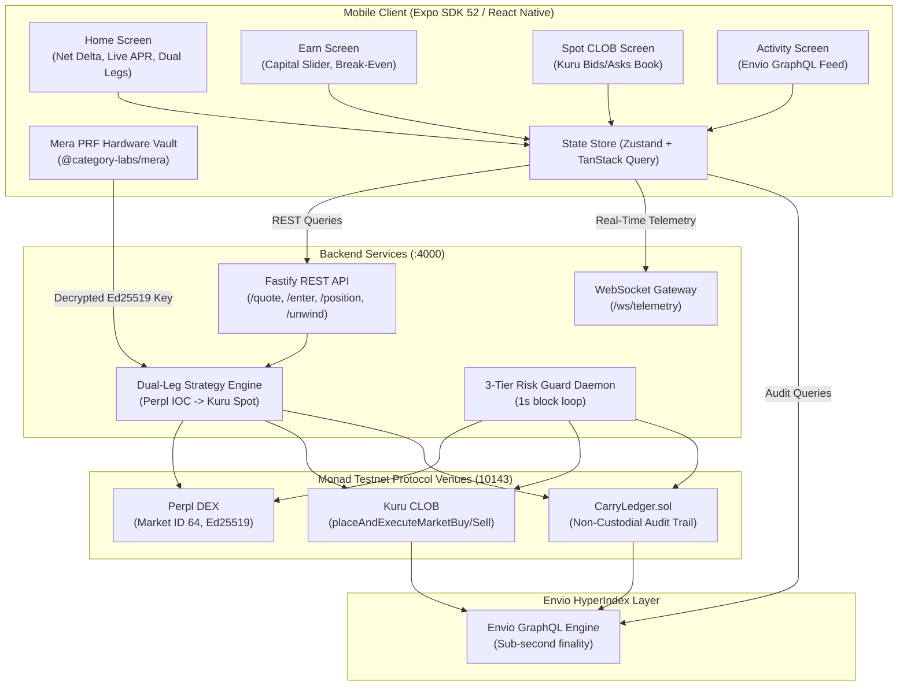

# Counter Yield: Phase 4, Phase 5 & Phase 6 Master Implementation Plan

**Mobile-Native Delta-Neutral Dollar Yield on Monad (`chainId: 10143`)**  
*Monad Metropolis Hackathon — Track 01: Onchain Finance & Trading*

---

## 1. Executive Summary & Design Vision

Counter Yield packages institutional funding-rate cash-and-carry arbitrage into a premier, mobile-first DeFi primitive on Monad. This plan outlines the complete implementation of:
1. **Phase 4: Mobile Client & UI Layer (Expo SDK 52 / React Native)**
2. **Phase 5: End-to-End Stress Testing & Onchain Verification**
3. **Phase 6: Submission Packaging, Demo Recording & Manual Verification Checklist**

### Aesthetic & UI/UX Principles (Late-2026 Mandate)
- **Palette**:
  - **Dark Charcoal / Obsidian Canvas**: Deep matte surface `#0A0D14` and surface elevation `#121620`, border slate `#1E2638`.
  - **Electric Light Yellowish-Green (Chartreuse Neon)**: Primary action & delta-neutral safety badge `#CCFF00` / `#D4FF33`.
  - **Snow White**: Headers and primary figures `#FFFFFF`, secondary neutral `#94A3B8`.
  - **Warning & Alarm Accents**: Amber `#FFB020` (Tier 1 & 2 warning) and Neon Crimson `#FF3B30` (Tier 3 emergency & unwind).
- **Navigation Architecture (Inspired by the Modern Trust Wallet Redesign)**:
  - **Thumb-Friendly Floating Glass Bottom Bar**: 4 dedicated tabs with frosted backdrop blur (`blurRadius={20}`), glowing chartreuse active pills:
    1. **Home / Vault**: Monad Testnet badge, total AUSD earning balance, glowing Net Delta badge ($\Delta = \$0.00$), circular quick-actions (Deposit, Earn, Rebalance, Unwind), and dual-leg cards (Kuru Spot vs. Perpl Perp 1x Short).
    2. **Earn / Sizer**: Capital slider, 10% reserve buffer calculation, break-even days estimator, and 1-tap Start Earning execution.
    3. **Spot CLOB (Kuru Track Requirement)**: Direct onchain Central Limit Order Book visualizer with live L2 bids/asks and direct spot buy/sell widget.
    4. **Activity / History (Envio Track)**: Envio HyperIndex GraphQL-powered chronological transaction feed with MonadScan hyperlinks.
  - **Modal Layers**: 
    - Biometric Passkey Unlock (`@category-labs/mera` PRF Vault).
    - 3-Tier Risk Guard Monitor & Distance-to-Liquidation gauge.
    - Emergency 1-Tap Unwind Confirmation with haptic feedback.

---

## 2. Technical Architecture & Component Connectivity

---

## 3. Phase 4: Mobile Implementation Specification

### 3.1 Dependency & Environment Setup (`mobile/package.json`)
- React Native 0.76+ / Expo SDK 52
- NativeWind v4 + TailwindCSS
- Lucide React Native icons
- React Native Reanimated 3 + Gesture Handler
- `@category-labs/mera` + WebCrypto / PRF adapters
- TanStack Query v5 + Zustand

### 3.2 State & Service Layer ("UI is a Reflection" Mandate)
1. `src/state/store.ts`:
   - Global reactive state for active position, wallet AUSD balance, passkey session, and live telemetry ticks.
2. `src/state/hooks/usePosition.ts`:
   - Polling / WS subscription hook for real-time margin ratio, distance to liquidation, and estimated vs. settled funding.
3. `src/state/hooks/useKuruBook.ts`:
   - Direct L2 order book streaming hook for the Kuru Spot tab.
4. `src/auth/meraAuth.ts` & `src/auth/prfVault.ts`:
   - Biometric passkey creation and hardware-isolated PRF vault unlocking.

### 3.3 UI Screens & Components
1. **WelcomeScreen**: Biometric Face ID passkey prompt with illuminated shield and zero wallet jargon.
2. **HomeScreen**:
   - Total earning balance in snow white (`$12,450.00 AUSD`).
   - Glowing chartreuse delta-neutral badge (`Δ = $0.00`).
   - Circular action buttons (Deposit, Earn, Rebalance, Unwind).
   - Interactive dual-leg cards with miniature depth bars.
3. **StartEarningScreen**:
   - Sizing slider with real-time 10% reserve buffer feedback ($1,000 -> 100 reserve, 450 spot, 450 perp margin).
   - Break-even calculator card displaying days to profit based on current funding rates and round-trip taker fees.
4. **PositionScreen**:
   - Visual 3-tier margin defense ladder (Tier 1 Top-Up, Tier 2 Deleverage, Tier 3 Emergency).
   - Semi-circular distance-to-liquidation gauge (`78.4% Safe Zone`).
   - One-Tap Unwind button with dual confirmation sheet.
5. **SpotScreen (Kuru CLOB)**:
   - Live bid/ask order book depth with green/red spread bars.
   - Quick spot buy/sell input form for standalone trading.
6. **ActivityScreen**:
   - Envio HyperIndex GraphQL transaction cards with direct links to MonadScan testnet.

---

## 4. Phase 5: Stress Testing & Onchain Verification

1. **Monad Testnet RPC & Gas Verification**:
   - Ensure declared gas limits in Viem transactions match Foundry benchmarks (openHedge: 411k, rebalance: 57k, guard: 38k, close: 92k).
2. **Automated Stress Harness Validation**:
   - Run backend stress suites simulating +25%, +45%, and +65% market spikes.
   - Confirm two-consecutive-block confirmation for Tier 3 emergency unwinds.
3. **Dual-Leg Safety Drill**:
   - Verify 3-second timeout fallback: if Kuru spot buy fails, Perpl short immediately flattens via reduce-only IOC order.

---

## 5. Phase 6: Hackathon Submission & All Remaining Manual Steps

Phase 6 contains the mandatory human-in-the-loop steps required to successfully submit to the Monad Metropolis Hackathon:

### Remaining Manual Steps Checklist:
1. **Testnet Faucet Funding (Manual)**:
   - Visit [faucet.monad.xyz](https://faucet.monad.xyz) and request testnet native `MON` gas to your designated deployer address.
   - Mint testnet `AUSD` from the Agora faucet contract (`0x00000000eFE302BEAA2b3e6e1b18d08D69a9012a`).
2. **Deploy `CarryLedger.sol` to Monad Testnet (Manual/Assisted)**:
   - Run `forge script contracts/script/DeployCarryLedger.s.sol --rpc-url https://testnet-rpc.monad.xyz --broadcast --private-key $DEPLOYER_KEY`.
   - Update `indexer/config.yaml` and `.env` with the deployed `CarryLedger` address.
   - Append deployment transaction hash to `TX_LOG.md`.
3. **Physical Smartphone Demo Recording (Manual)**:
   - Install the Expo Go or test build on an iPhone/Android device with Face ID / biometric passkey capability.
   - Record an unedited **3-minute Loom / video** demonstrating:
     - Biometric passkey login (Mera PRF vault).
     - Depositing AUSD & reviewing the break-even calculator.
     - Single-tap "Start Earning" entry with live MonadScan confirmation.
     - Inspection of the Kuru CLOB order book tab.
     - Inspection of the 3-Tier Risk Guard ladder.
     - Single-tap "Unwind" reverting capital to 100% AUSD.
4. **Final Hackathon Submission Form (Manual)**:
   - Submit project link on the Monad Metropolis Hackathon portal.
   - Select tracks: **Track 01 (Onchain Finance & Trading)** and sponsor bounties (**Agora, Kuru, Perpl, Monad Mera UX, Monad PRF, Envio**).
   - Attach demo video link, GitHub repository URL, and `TX_LOG.md`.
