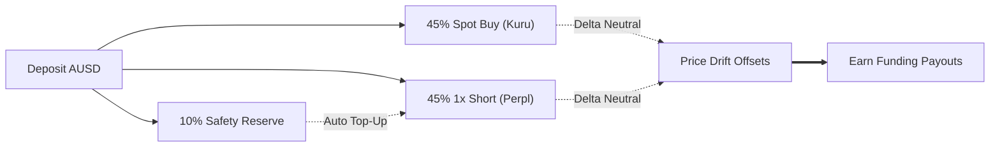

<div align="center">

# CounterYield

<p><strong>1-Tap Delta-Neutral Carry on Monad Testnet</strong></p>
<p>Collects funding rate yield with zero directional exposure.</p>

<p align="center">
  <a href="https://testnet.monadscan.com"></a>
  <a href="https://agora.finance"></a>
  <a href="https://kuru.io"></a>
  <a href="https://perpl.xyz"></a>
  <a href="LICENSE"></a>
</p>

<p align="center">
  <a href="#how-it-works">How It Works</a> &bull;
  <a href="#risk-guard">Risk Guard</a> &bull;
  <a href="#security">Security</a> &bull;
  <a href="#contracts">Contracts</a> &bull;
  <a href="#quick-start">Quick Start</a> &bull;
  <a href="#updates">Updates</a> &bull;
  <a href="#mentor-notes--whats-next">Mentor Notes</a>
</p>


</div>

---

## How It Works

Deposit AUSD. The engine splits capital into three parts:
- **10% Safety Buffer**: Kept in reserve to defend margin.
- **45% Spot Buy**: Buys MON on Kuru's central limit order book.
- **45% Short Hedge**: Opens an equal 1x short on Perpl.

Price changes on MON offset each other. The position earns perpetual funding payouts (~18.4% APY).



---

## Risk Guard

When MON climbs, short margin shrinks. An automated daemon checks margin health on every block:

| Trigger | Level | Action Taken |
| :--- | :--- | :--- |
| **Normal** | $\ge 60\%$ | Idle monitoring on every Monad block. |
| **Tier 1: Top-Up** | $40\% - 60\%$ | Routes funds from the 10% reserve into the short position. |
| **Tier 2: Trim** | $25\% - 40\%$ | Sells 20% spot MON on Kuru and closes 20% short to reset leverage. |
| **Tier 3: Unwind** | $< 25\%$ (2 blocks) | Closes both legs to 100% AUSD cash before liquidation hits. |

Users can also tap **Unwind** anytime to exit both legs to cash immediately.

---

## Security

No seed phrases. Keys stay in hardware:
- **Biometric Sign-In**: Unlocks via Face ID, Touch ID, or device passcode.
- **Hardware Enclave**: Keys are derived locally through WebAuthn PRF.
- **Device Vault**: Encrypted with AES-256-GCM. Private keys never leave the phone.

---

## Contracts

| Component | Identifier / Address |
| :--- | :--- |
| **Chain** | Monad Testnet (`chainId: 10143`) |
| **RPC** | `https://testnet-rpc.monad.xyz` |
| **Agora AUSD** | `0x00000000eFE302BEAA2b3e6e1b18d08D69a9012a` |
| **CarryLedger** | [`0x9998a7776edddf2f2ab6ffbb9420e5194a50f906`](https://testnet.monadscan.com/address/0x9998a7776edddf2f2ab6ffbb9420e5194a50f906) |
| **Kuru Router** | `0x7EFbE105Ca7415dE98F96622173458ac1c054630` |
| **Perpl Market** | Market ID: `64` (MON Perp) |

---

## Quick Start

```bash
# 1. Install workspace dependencies
npm install

# 2. Run backend (API + WS telemetry on port 4000)
npm --prefix backend run dev

# 3. Run the 15-test risk and harness test suite
npm --prefix backend test

# 4. Launch mobile client (Expo 51)
npm --prefix mobile start
```

---

## Updates

- [Update 1: Dual-Leg Execution Engine](updates/01-dual-leg-execution-engine.md) — Atomic Kuru spot buy + Perpl 1x short routing.
- [Update 2: Automated Risk Guard](updates/02-automated-risk-guard-and-carryledger.md) — 3-tier margin defense and deployed `CarryLedger.sol`.
- [Update 3: Seedless Biometric Mobile Client](updates/03-seedless-biometric-mobile-client.md) — WebAuthn PRF auth with live Monad telemetry.

---

## Mentor Notes & What's Next

During the hackathon, mentors stress-tested our core assumptions. Here is what they flagged and how we handle it:

- **Volatility spikes & margin calls** (gvan, Perpl): If MON pumps hard, the short leg needs margin fast. Our engine checks health every block and auto-sells spot MON on Kuru to fund Perpl collateral before liquidation hits.
- **Negative funding rate drag** (gvan, Perpl): If funding drops below zero or fails to cover exchange fees, the circuit breaker halts new buys and unwinds open legs into bids.
- **Sub-500ms query speed** (Denham, Envio): Pure RPC calls are too slow for real-time mobile UX on high-throughput chains. We stream live data over WebSockets for instant UI response and let Envio HyperIndex index historical events in the background.
- **shMON liquid staking yield** (Swaraj): Instead of holding plain MON on spot, buying FastLane's shMON stacks base staking rewards on top of funding rate payouts, pushing delta-neutral yield past 20%. Added to our post-hackathon roadmap.

---

## License

[MIT License](LICENSE)
