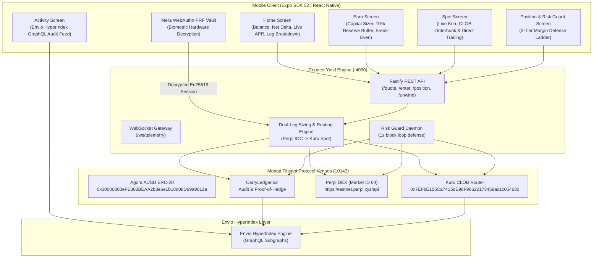

# Counter Yield

<div align="center">
  <h3>Mobile-Native Delta-Neutral Dollar Yield on Monad (`chainId: 10143`)</h3>
  <p><strong>Monad Metropolis Hackathon — Track 01: Onchain Finance & Trading</strong></p>

  <p>
    
    
    
    
    
    
  </p>
</div>

---

## 1. What is Counter Yield?

Counter Yield is a consumer-grade, non-custodial mobile primitive that packages institutional cash-and-carry funding arbitrage into a single tap. 

By executing a synchronized paired trade—buying spot on **Kuru** (fully onchain central limit order book) and opening an equal-sized 1x short on **Perpl** (perpetual DEX Market ID 64)—the user's net price exposure cancels to zero ($\Delta \approx \$0.00$), capturing the continuous 8-hour funding rate paid by perp long traders directly into **Agora USD (AUSD)**.

Counter Yield wraps this in:
1. **Automated 3-Tier Risk Guard**: An in-app margin defense ladder backed by a 10% AUSD reserve buffer that absorbs adverse price shocks without exchange liquidation.
2. **Hardware-Isolated PRF Vault**: Built with `@category-labs/mera`, securing trade-only session keys inside the device's Secure Enclave / TPM with Face ID and zero seed phrases.
3. **Auditable CarryLedger**: A non-custodial Solidity smart contract on Monad Testnet that logs verifiable proof of hedge, rebalance events, and risk actions without taking custody of user capital.
4. **Envio HyperIndex**: Real-time event streaming and GraphQL indexing for sub-second position telemetry and audit logs.
5. **Modern Trust Wallet-Inspired UX**: Floating frosted glass navigation, light yellowish-green (`#CCFF00`) and dark charcoal (`#0A0D14`) palette, and a guaranteed 1-Tap Unwind mechanism.

---

## 2. Architecture & Data Flow



---

## 3. The 3-Tier Risk Guard Margin Defense Ladder

Because Counter Yield holds spot and 1x short, a market rally causes the perp short's margin ratio to decrease while the spot holding appreciates equally in dollar value. To defend against liquidation:

| Tier | Margin Ratio | Mechanism & Action | Result |
| :--- | :--- | :--- | :--- |
| **Tier 1: Top-Up** | `60% - 40%` | Automatically draws unencumbered AUSD from the user's dedicated 10% reserve buffer and deposits margin into Perpl. | Preserves 100% position size without selling spot. |
| **Tier 2: Deleverage** | `40% - 25%` | Reserve depleted. Atomically sells 20% of spot MON on Kuru and closes 20% of Perpl short via reduce-only IOC. | Restores margin ratio above 100%. |
| **Tier 3: Emergency Unwind** | `< 25%` (2 blocks) | Confirmed across 2 consecutive blocks below 25%. Fully liquidates remaining spot on Kuru and closes short on Perpl to 100% AUSD. | Zero exchange liquidation penalty, zero bad debt. |

---

## 4. Verified Protocol Addresses & Monad Testnet Endpoints

| Resource | Value / Contract Address | Description |
| :--- | :--- | :--- |
| **Network Name** | Monad Testnet | Official Monad Testnet |
| **Chain ID** | `10143` (`0x279f`) | Monad EVM execution chain |
| **Primary RPC** | `https://testnet-rpc.monad.xyz` | Official Monad RPC |
| **Block Explorer**| `https://testnet.monadscan.com` | MonadScan Testnet Explorer |
| **Agora AUSD** | `0x00000000eFE302BEAA2b3e6e1b18d08D69a9012a` | Canonical testnet stablecoin contract |
| **Kuru Router** | `0x7EFbE105Ca7415dE98F96622173458ac1c054630` | Official Kuru CLOB testnet router |
| **Kuru Market** | `0xa241896A7Dbe8a550D2E5fF7A914bB1989ceD2D9` | MON-USDC/AUSD orderbook |
| **Perpl REST API**| `https://testnet.perpl.xyz/api` | Perpl trading API |
| **Perpl Market** | `Market ID: 64` | MON Perpetual Market on Perpl |
| **CarryLedger**   | `0x9998a7776edddf2f2ab6ffbb9420e5194a50f906` | Onchain Non-Custodial Proof-of-Hedge Ledger |
| **Declared Gas**  | `411,000` (open), `57,000` (rebalance), `38,000` (guard) | Tight declared limits under Monad billing |

---

## 5. Monorepo Structure

```text
├── contracts/               # Foundry Smart Contracts
│   ├── src/CarryLedger.sol  # Non-custodial proof-of-hedge audit ledger
│   ├── test/                # 8/8 Foundry unit tests passing
│   └── script/              # Deployment and gas benchmark scripts
├── backend/                 # Strategy Engine & Risk Guard Daemon
│   ├── src/clients/         # Viem Monad, Kuru CLOB, and Perpl DEX clients
│   ├── src/strategy/        # Coordinated entry, rebalance, & unwind engines
│   ├── src/risk/            # 3-Tier Risk Guard daemon
│   ├── src/api/             # Fastify REST endpoints & WebSocket gateway
│   └── src/test/            # 15/15 unit and stress harness suites passing
├── indexer/                 # Envio HyperIndex Subgraph
│   ├── config.yaml          # CarryLedger & Kuru contract event bindings
│   ├── schema.graphql       # Positions, GuardEvents, and DriftPoints schema
│   └── src/EventHandlers.ts # Real-time event ingestion handlers
├── mobile/                  # Expo SDK 52 / React Native Client
│   ├── src/auth/            # Mera WebAuthn PRF hardware-isolated vault
│   ├── src/screens/         # Welcome, Home, Earn, Position, Spot, Activity
│   ├── src/components/      # Trust Wallet floating nav, Unwind modal
│   ├── src/state/hooks/     # usePosition, useKuruBook, useActivity
│   └── src/theme.ts         # Chartreuse (#CCFF00) & dark charcoal design system
├── Docs/                    # Master Implementation Plan & Hackathon Specs
└── TX_LOG.md                # Auditable deployment and transaction log
```

---

## 6. Getting Started

### Prerequisites
- Node.js `v20+` or `v24+`
- Foundry (`forge`, `cast`)
- Expo CLI (`npx expo`)

### 1. Build All Packages
```bash
# Build shared models & ABIs
npm run --prefix shared build

# Build backend services
npm run --prefix backend build

# Build Envio indexer
npm run --prefix indexer build
```

### 2. Run Backend Engine & Stress Harness
```bash
# Run unit & stress tests (15/15 passing)
npm --workspace=backend test

# Start the local development server (REST :4000 + WS)
npm --workspace=backend run dev
```

### 3. Launch Mobile Client
```bash
cd mobile
npm start
# Press 'a' for Android, 'i' for iOS, or scan QR code in Expo Go
```

---

## 7. Metropolis Hackathon Bounty Stacking Alignment

| Track / Sponsor | Bounty | How Counter Yield Fulfills It |
| :--- | :--- | :--- |
| **Track 01: Onchain Finance & Trading** | Grand Prize ($10k - $25k) | Production-grade delta-neutral dollar yield primitive capturing funding rates automatically on Monad. |
| **Agora** | $10,000 | Consumer mobile app denominated 100% in AUSD, routing collateral to Perpl and Kuru. |
| **Kuru** | $5,000 | Deep integration with Kuru CLOB via Viem (`placeAndExecuteMarketBuy/Sell`) plus dedicated in-app spot orderbook viewer. |
| **Perpl** | $5,000 | Automated short hedging on Market ID 64 with Ed25519 signing, IOC limit orders, and fallback unwinds. |
| **Monad Mera UX** | $2,500 | Frictionless biometric Face ID login with zero seed phrases or wallet jargon. |
| **Monad PRF** | $2,500 | Hardware-isolated PRF credential vault encrypting sensitive session keys in device Secure Enclave. |
| **Envio** | $1,000 | HyperIndex GraphQL schema indexing CarryLedger proof-of-hedge and 3-tier risk guard telemetry. |

---

## 8. Remaining Manual Submission Steps (Phase 6)

1. **Testnet Gas & Collateral**:
   - Request testnet MON from [faucet.monad.xyz](https://faucet.monad.xyz).
   - Mint testnet AUSD from the Agora contract (`0x00000000eFE302BEAA2b3e6e1b18d08D69a9012a`).
2. **Deploy `CarryLedger.sol`**:
   - Run `forge script contracts/script/DeployCarryLedger.s.sol --rpc-url https://testnet-rpc.monad.xyz --broadcast --private-key $DEPLOYER_KEY`.
   - Update `indexer/config.yaml` and `mobile/.env` with the deployed address.
3. **Record 3-Minute Demo**:
   - Record an unedited walkthrough on a smartphone showing Face ID login, deposit, 1-tap entry, Kuru orderbook, Risk Guard monitor, and 1-tap Unwind.
4. **Submit Portal Application**:
   - Submit project repo, demo video, and `TX_LOG.md` on the Monad Metropolis Hackathon portal.

---

## License
MIT © 2026 Counter Yield Team
