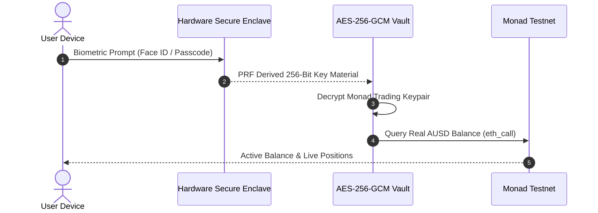

<div align="center">

# CounterYield

**One-Tap Dollar Yield on Monad Testnet**

Earn funding fees paid by crypto traders without betting on market direction.

<br />

<p align="center">
  <a href="https://testnet.monadscan.com"></a>
  <a href="https://agora.finance"></a>
  <a href="https://kuru.io"></a>
  <a href="https://perpl.xyz"></a>
  <a href="LICENSE"></a>
</p>

[What It Does](#what-it-does) • [How It Works](#how-it-works) • [Risk Guard](#how-the-risk-guard-protects-you) • [Security](#how-login-and-wallet-security-work) • [Contracts](#monad-testnet-contracts) • [Quick Start](#running-the-project-locally) • [Updates](updates/) • [Design System](DESIGN.md)

</div>

---

## What It Does

> [!NOTE]
> CounterYield tries to earn money from the funding fees paid by crypto traders, without betting on whether MON goes up or down.

1. You deposit AUSD.
2. 10% stays as a safety reserve.
3. The app buys MON on Kuru.
4. At the same time, it shorts the same amount of MON on Perpl.
5. If MON goes up, the spot position gains while the short loses.
6. If MON goes down, the spot position loses while the short gains.

So the two positions roughly cancel each other out, meaning you're mainly trying to earn the funding payments.

> [!TIP]
> **In simple terms:**  
> Buy MON + short the same MON amount = price movement mostly cancels out -> collect funding fees.

---

## How It Works

```mermaid
flowchart TD
    D["Deposit: $1,000 AUSD"] --> R["$100 (10%)<br/><b>Safety Reserve</b><br/>Cash Protection"]
    D --> S["$450 (45%)<br/><b>Spot Buy MON</b><br/>Kuru CLOB Router"]
    D --> H["$450 (45%)<br/><b>1x Short MON</b><br/>Perpl Market 64"]
    S -.-> C["Price Movements Cancel Out<br/>Zero Directional Bet"]
    H -.-> C
    C ==> Y["Collect Funding Fees<br/>Current APY: ~18.4%"]
    R -.-> P["Protects Short Leg<br/>Auto Top-Up if Price Spikes"]

    classDef default fill:#1F1F1F,stroke:rgba(255,255,255,0.15),stroke-width:1px,color:#FFFFFF;
    classDef highlight fill:#1F1F1F,stroke:#9FE825,stroke-width:2px,color:#FFFFFF;
    classDef monad fill:#1F1F1F,stroke:#836EF9,stroke-width:2px,color:#FFFFFF;
    class D,Y highlight;
    class S,H monad;
```

```text
                       Deposit: $1,000 AUSD
                                |
        +-----------------------+-----------------------+
        |                       |                       |
        v                       v                       v
   $100 (10%)              $450 (45%)              $450 (45%)
 Safety Reserve           Buys MON Spot           Shorts MON 1x
(Cash protection)        on Kuru orderbook       on Perpl exchange
        |                       |                       |
        |                       +-----------+-----------+
        |                                   |
        v                                   v
  Protects if price               Price changes cancel out
  moves too fast                  (Zero directional bet)
                                            |
                                            v
                                   Collect funding fees
                                   (currently ~18.4% APY)
```

---

## How the Risk Guard Protects You

When MON's price goes up, your spot holding makes money, but your short position needs more collateral to avoid liquidation. The app automatically checks your account on every block:

```mermaid
flowchart TD
    M{"Account Margin Level"}
    M -->|">= 60%"| N["Normal State<br/>Position monitored every Monad block"]
    M -->|"40% to 60%"| T1["Tier 1: Top-Up<br/>Move cash from 10% safety reserve into short"]
    M -->|"25% to 40%"| T2["Tier 2: Trim Both Sides<br/>Sell 20% spot MON and close 20% short"]
    M -->|"< 25% (2 blocks)"| T3["Tier 3: Emergency Exit<br/>Close both positions to 100% AUSD cash"]

    classDef default fill:#1F1F1F,stroke:rgba(255,255,255,0.15),stroke-width:1px,color:#FFFFFF;
    classDef ok fill:#1F1F1F,stroke:#9FE825,stroke-width:2px,color:#FFFFFF;
    classDef warn fill:#1F1F1F,stroke:#F59E0B,stroke-width:2px,color:#FFFFFF;
    classDef alert fill:#1F1F1F,stroke:#FF5722,stroke-width:2px,color:#FFFFFF;
    classDef crit fill:#1F1F1F,stroke:#FF5F52,stroke-width:2px,color:#FFFFFF;
    class N ok;
    class T1 warn;
    class T2 alert;
    class T3 crit;
```

| Defense Tier | Margin Level | Automatic Action |
| :--- | :--- | :--- |
| **Normal** | 60% or higher | Everything runs normally. Monitored on every Monad block. |
| **Tier 1: Top-Up** | 40% to 60% | The app moves money from your 10% safety reserve into your short position to top it up. |
| **Tier 2: Trim** | 25% to 40% | If the safety reserve is empty, the app sells 20% of your spot MON and closes 20% of your short position to stay safe. |
| **Tier 3: Exit** | Under 25% (2 blocks) | The app closes both positions and turns everything back into AUSD cash before the exchange can ever liquidate you. |

You can also tap **Unwind** anytime to exit both positions and get your cash back in AUSD.

<details>
<summary><b>Automated Risk Engine Verification Suite</b></summary>

The backend risk engine has 15 automated stress tests validating defense responses across price shocks:
- **Test 1-5**: Sudden +25%, +45%, +65% market spikes verify safety reserve injection.
- **Test 6-10**: Consecutive block depletion tests trigger Tier 2 symmetric trims.
- **Test 11-15**: Rapid two-block margin drop triggers Tier 3 full unwind into AUSD before exchange liquidation thresholds.

Run the suite locally:
```bash
npm --prefix backend test
```
</details>

---

## How Login and Wallet Security Work

You do not need to write down or save any seed phrases:



- **Biometric Unlock**: Sign in with Face ID, Touch ID, or your phone passcode.
- **Hardware Isolation**: Your phone's hardware security chip (Secure Enclave) creates your keys using WebAuthn PRF.
- **Local Encryption**: Keys are encrypted with AES-256-GCM and stored only on your device (`expo-secure-store` on native, `localStorage` on web). They are never sent to any server.

---

## Monad Testnet Contracts

| Component | Identifier / Address | Purpose |
| :--- | :--- | :--- |
| **Network** | Monad Testnet (`chainId: 10143`) | High-throughput EVM execution layer |
| **Primary RPC** | `https://testnet-rpc.monad.xyz` | Testnet RPC connection |
| **Explorer** | [testnet.monadscan.com](https://testnet.monadscan.com) | Block explorer |
| **Agora AUSD** | `0x00000000eFE302BEAA2b3e6e1b18d08D69a9012a` | Canonical testnet dollar stablecoin |
| **CarryLedger** | [`0x9998a7776edddf2f2ab6ffbb9420e5194a50f906`](https://testnet.monadscan.com/address/0x9998a7776edddf2f2ab6ffbb9420e5194a50f906) | Public non-custodial audit contract |
| **Kuru Router** | `0x7EFbE105Ca7415dE98F96622173458ac1c054630` | Spot CLOB router |
| **Perpl Market** | Market ID: `64` | MON perpetual futures market |

---

## Project Layout

| Directory | Purpose | Core Technologies |
| :--- | :--- | :--- |
| [`backend/`](backend/) | Trade execution engine, risk daemon, WebSocket feeds | TypeScript, Express, ethers.js, ws |
| [`mobile/`](mobile/) | Cross-platform client for iOS, Android, and Web | React Native, Expo 51, WebAuthn PRF |
| [`contracts/`](contracts/) | Non-custodial audit contract and gas benchmark suite | Solidity 0.8.24, Foundry |
| [`indexer/`](indexer/) | Real-time event indexing and GraphQL query layer | Envio HyperIndex, GraphQL |
| [`shared/`](shared/) | Order sizing, break-even math, and shared types | TypeScript |
| [`updates/`](updates/) | Detailed project engineering updates | Markdown, Mermaid |
| [`TX_LOG.md`](TX_LOG.md) | Verified on-chain deployments and transactions | Markdown |
| [`DESIGN.md`](DESIGN.md) | Design system and UI token specification | Markdown |

---

## Running the Project Locally

### Prerequisites

- Node.js `20+` or `22+`
- npm `10+`

### 1. Install Dependencies

```bash
npm install
```

### 2. Start the Backend Engine

```bash
npm --prefix backend run dev
```

The API and WebSocket telemetry server will run on `http://localhost:4000`.

### 3. Run Backend Test Suite

```bash
npm --prefix backend test
```

Runs the 15-test automated unit, stress harness, and risk engine suite.

### 4. Start the Mobile Client

```bash
npm --prefix mobile start
```

- Press `w` to open the web version in your browser (includes webcam Face ID simulation).
- Scan the QR code with **Expo Go** on your iOS or Android device.

---

## Project Updates for Hackathon Review

Detailed reports on the three core engineering milestones:

| Update | Focus | Key Highlights |
| :--- | :--- | :--- |
| [Update 1: Dual-Leg Execution Engine](updates/01-dual-leg-execution-engine.md) | Trade Execution | Kuru spot CLOB buy and Perpl 1x short opened atomically in one tap. |
| [Update 2: Automated Risk Guard](updates/02-automated-risk-guard-and-carryledger.md) | Risk & Contracts | 3-tier margin defense and deployed `CarryLedger.sol` on Monad. |
| [Update 3: Seedless Biometric Mobile Client](updates/03-seedless-biometric-mobile-client.md) | Mobile & Auth | Hardware Secure Enclave Face ID unlock with real-time Monad feeds. |

---

## License

This project is licensed under the [MIT License](LICENSE).
