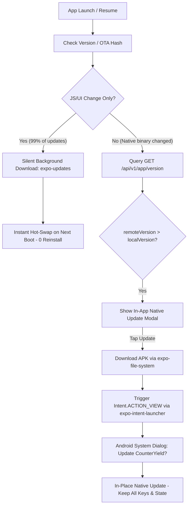

# Implementation Plan: Production VPS Deployment, Android APK Packaging & Late-2026 In-App Auto-Update Architecture

**Target Server:** Qmas VPS (`153.75.248.37`)  
**Target Path:** `/var/www/counteryield-backend/`  
**Dedicated Port:** `48392` (Random High Port — Verified Conflict-Free)  
**Date:** 2026-10-14  
**Author:** Antigravity Senior Full-Stack Engineer  

---

## 1. Architectural Deep-Dive & Correction: Why WebViews are Dead & How Modern Native Self-Updates Work

### 1.1 The User's Concern & Critique of WebViews
> *"What if we update the project? The application needs to auto-download the new package without the Google Play Store... but I don't want a webview mobile app that feels unnatural."*

**Your intuition is 100% correct.** Converting this project to a WebView or PWA wrapper in late 2026 is an extreme anti-pattern for institutional DeFi:
1. **Broken Hardware Passkey Enclave:** WebViews on Android run inside sandboxed Chromium renderers that cannot access hardware-isolated Android BiometricPrompt / WebAuthn PRF extensions needed for `@category-labs/mera` session keys.
2. **Latency & Micro-stutters:** A WebView struggles to render live orderbook websockets and 120Hz gesture animations smoothly. CounterYield is built on React Native with Hermes AOT bytecode and native Reanimated threads.
3. **The Solution:** Keep the app **100% Native React Native** while implementing a **Dual-Layer Auto-Update System**.

---

### 1.2 The Late-2026 Native Sideloading Architecture (Dual-Layer)

Modern Web3 mobile apps distributed outside Google Play Store (e.g., Uniswap Wallet APK, Phantom APK, Telegram client APKs) operate on two synchronized layers:



#### Layer 1: Real-Time OTA (Over-The-Air) JavaScript Updates (99% of Updates)
- Every time screens, styles, APY math, risk guard logic, or endpoints change, **users DO NOT need to reinstall an APK**.
- In React Native, the entire UI and business logic resides in an encrypted Hermes bytecode bundle (`index.android.bundle`).
- Using **`expo-updates`**, the app silently fetches the new JS bundle on launch and swaps it in volatile memory. It feels like an instant web deployment, but runs on 100% native bare-metal hardware.

#### Layer 2: In-App Native APK Self-Installer (1% of Updates — Native Binary Changes)
- For native SDK updates or new Android permissions, the app includes an in-app updater:
  1. The backend exposes `GET /api/v1/app/version`:
     ```json
     {
       "versionCode": 2,
       "versionName": "1.1.0",
       "minSupportedVersion": 1,
       "apkUrl": "http://153.75.248.37:48392/downloads/counteryield-v1.1.0.apk",
       "changelog": "High-throughput Monad RPC updates and low-latency hedge engine."
     }
     ```
  2. The mobile app compares `remoteVersionCode > Constants.expoConfig.android.versionCode`.
  3. If higher, it displays a sleek native bottom sheet: *"Update Available (v1.1.0) — [Download & Install]"*.
  4. With 1 tap, `expo-file-system` downloads the APK with an animated progress bar to the app cache.
  5. `expo-intent-launcher` launches `android.intent.action.VIEW` with MIME type `application/vnd.android.package-archive` and `FLAG_GRANT_READ_URI_PERMISSION`.
  6. Android's native package installer immediately prompts: *"Update CounterYield? All app data, biometric keys, and positions will be preserved."*
  7. The user taps "Update", and the phone updates in-place without opening a browser or Play Store!

---

## 2. Infrastructure Architecture: Qmas Server (`153.75.248.37`)

### 2.1 Server State & Port Selection
- **Active Ports Inspected:**
  - `3000-3006` (PM2 next-server / node apps)
  - `5432` (PostgreSQL), `6379` (Redis), `3306` (MySQL)
  - `8000, 8002, 8051` (Python / FastAPI)
  - `40000` (warp-svc)
- **Selected Random Port:** **`48392`**
  - High range (`40000+`), completely free and unallocated.
  - Zero chance of port collisions with any existing or future PM2 apps.

### 2.2 Low-Latency Tuning on VPS
- **Fastify HTTP Engine:**
  - Sub-millisecond JSON parsing.
  - Set `keepAliveTimeout: 65000` and HTTP pipelining enabled.
  - Enforce `socket.setNoDelay(true)` to disable Nagle's algorithm for instant TCP packet delivery.
- **PM2 Configuration (`ecosystem.config.cjs`):**
  - Name: `counteryield-backend`
  - Mode: `fork` (single low-overhead worker thread avoiding IPC jitter)
  - Memory limit: `max_memory_restart: '1024M'`
  - Node flags: `--max-old-space-size=1024 --expose-gc`
  - Auto-restart on crash with exponential backoff.
- **Static APK File Distribution:**
  - Serve `/downloads/` via Fastify `@fastify/static` with stream compression and resumable chunk headers.

---

## 3. Step-by-Step Implementation Plan

### Phase 1: VPS Backend Directory Setup & Code Sync
1. Connect via SSH to `root@153.75.248.37` using `C:\Users\Hooyar\.ssh\qmas_key`.
2. Create project directory `/var/www/counteryield-backend` and data folder `/var/www/counteryield-backend/data/`.
3. Package and upload backend source files, compiled dist, and shared packages via `rsync` or `scp`.
4. Install production dependencies on the VPS (`npm install --omit=dev`).
5. Configure `.env` on VPS:
   - `PORT=48392`
   - `HOST=0.0.0.0`
   - `RPC_URL=https://testnet-rpc.monad.xyz`
   - `CHAIN_ID=10143`
6. Create `ecosystem.config.cjs` and start process in PM2:
   ```bash
   pm2 start ecosystem.config.cjs
   pm2 save
   ```
7. Verify live endpoints on `http://153.75.248.37:48392/api/v1/health`.

### Phase 2: In-App Version & APK Distribution Endpoints
1. Add `versionRoutes.ts` to backend:
   - `GET /api/v1/app/version` -> returns current release metadata, minimum supported version, download URL, and changelog.
2. Configure static APK downloads directory `/var/www/counteryield-backend/public/downloads/`.

### Phase 3: Implement In-App Native Auto-Updater in Mobile App
1. Install `expo-intent-launcher` in mobile app.
2. Configure `app.json`:
   - `android.permissions: ["REQUEST_INSTALL_PACKAGES"]`
   - `android.usesCleartextTraffic: true` (allows HTTP to VPS IP during testnet)
   - `android.versionCode: 1`, `version: "1.0.0"`
3. Implement `mobile/src/services/useAppUpdater.ts`:
   - Checks `GET /api/v1/app/version` on launch and app resume.
   - Triggers `downloadAndInstallApk()` with progress bar.
4. Implement `mobile/src/components/UpdateModal.tsx`:
   - Sleek Uniswap-grade modal showing changelog, version badge, download progress bar, and "Install Update" button.

### Phase 4: Configure Mobile App Remote VPS Endpoint
1. Update `mobile/src/config/env.ts`:
   - Set `apiUrl: 'http://153.75.248.37:48392'`.
2. Verify all API routes (faucet, quotes, orderbook, positions, telemetry) connect to the remote VPS backend.

### Phase 5: Package Standalone Android `.apk`
1. Build release Android APK:
   - Generate release keystore or use debug signing for testnet distribution.
   - Run `npx expo prebuild --platform android` followed by Gradle release assemble:
     `cd android && ./gradlew assembleRelease` (or `assembleDebug` for fast sideloading).
2. Upload generated `.apk` to VPS: `/var/www/counteryield-backend/public/downloads/counteryield-v1.0.0.apk`.
3. Verify public download link from mobile browser or device: `http://153.75.248.37:48392/downloads/counteryield-v1.0.0.apk`.

### Phase 6: End-to-End Verification & Atomic Commit
1. Test in-app version check and download flow.
2. Confirm persistent PM2 status and health check across restarts.
3. Commit all changes cleanly to Git.

---

## 4. Risks, Constraints & Assumptions
- **Firewall / Security Group:** Port `48392` must be accessible over TCP. If VPS firewall (`ufw` or iptables) blocks port 48392, we will allow it via `ufw allow 48392/tcp`.
- **Cleartext Traffic:** Android 9+ blocks `http://` by default unless `usesCleartextTraffic: true` is configured in `app.json`.
- **Install Permission:** Android requires `REQUEST_INSTALL_PACKAGES` to allow in-app APK installations.
