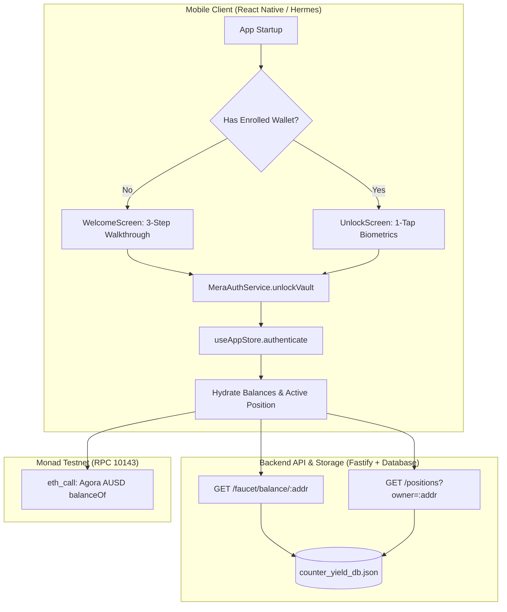

# Final Implementation Plan: Biometric Unlock, Zero-Loss State Persistence, AUSD Branding, Crash Resolution & Wallet Backup

**Branch:** `master`
**Date:** 2026-10-13
**Author:** Antigravity Senior Full-Stack Engineer

---

## 1. Current State Analysis & Flaw Detection

### Flaw 1: Hermes Runtime Render Crash on Portfolio Deposit (`PortfolioScreen.tsx:174:123`)
- **Current State:** Immediately after depositing testnet AUSD or entering a position, navigating to the Portfolio screen crashes with:
  `TypeError: undefined is not a function at PortfolioScreen.tsx (174:123)`
- **Root Cause Analysis:**
  1. In `backend/src/engine/strategyEngine.ts:192`, `shared/src/models/PositionModel.ts:26`, and `mobile/src/services/types.ts:20`, `netDeltaDollars` is defined and transmitted as a **string** (e.g. `"0.00"`).
  2. In `PortfolioScreen.tsx:87`:
     ```ts
     const netDelta = hasPosition ? activePosition?.netDeltaDollars || 0.0 : 0.0;
     ```
     When an active position is loaded from the backend or strategy engine, `netDelta` becomes `"0.00"`.
  3. In `PortfolioScreen.tsx:174`:
     ```ts
     `Spot: $${spotValueUsd.toFixed(0)} · Perp: -$${perpMarginUsd.toFixed(0)} · Net Δ: $${netDelta.toFixed(2)}`
     ```
  4. In JavaScript Hermes (React Native engine), strings do not possess a `.toFixed` method. Calling `"0.00".toFixed(2)` throws `TypeError: undefined is not a function`.
- **Solution:** Wrap all numeric formatting in `Number(val ?? 0).toFixed(...)` across `PortfolioScreen.tsx` and all downstream screens.

---

### Flaw 2: Placeholder "A" Monogram Instead of Official Agora AUSD Logo
- **Current State:** `mobile/src/components/Logos.tsx` renders a synthetic green SVG circle with a hardcoded letter "A" path.
- **Root Cause Analysis:** Real Agora AUSD branding (the official institutional USD stablecoin on Monad) was not bundled.
- **Solution:** Downloaded the authentic Agora AUSD PNG asset (3,367 bytes) into `mobile/assets/brands/ausd.png`. Update `AusdLogo` in `Logos.tsx` to render the genuine high-resolution branded token image with smooth rounded edges, matching professional crypto apps like Uniswap.

---

### Flaw 3: Cluttered "Break-Even Estimate" Card in Deposit Flow
- **Current State:** In `mobile/src/screens/StartEarningScreen.tsx` (lines 193–218), a "Return & Break-Even Metric Strip" card (`styles.estimatorCard`) displays `Est. Fees`, `Daily Carry`, and `Break-Even Days`.
- **User Mandate:** Remove this break-even div entirely to keep the 1-tap deposit experience focused, minimal, and uncluttered.
- **Solution:** Remove the entire `styles.estimatorCard` JSX block and its unused local calculations from `StartEarningScreen.tsx`.

---

### Flaw 4: Recurring 3-Step Educational Intro Modal on Every App Launch
- **Current State:** `mobile/App.tsx` checks `!isAuthenticated ? <WelcomeScreen /> : <DeFiApp />`. `WelcomeScreen` always initializes with `step = 1` (the 3-step slide deck introducing delta-neutral carry, DEXs, and passkeys).
- **User Pain Point:** Every time the user re-opens the app or refreshes, they are forced to page through the 3 introductory slides again.
- **Architecture Solution:**
  1. Add persistent onboarding status tracking (`hasCompletedOnboarding: boolean`) using `expo-secure-store` (native) and `localStorage` (web).
  2. First launch (new user): Show `WelcomeScreen` with the 3-step onboarding walkthrough and biometric setup.
  3. Subsequent launches (returning user with established enclave wallet): Present a dedicated, high-tech **`UnlockScreen.tsx`**:
     - Visual vault status: "Vault Locked"
     - Enclave account badge: `0x71C...3a9B` on Monad Testnet
     - Large, glowing biometric unlock button ("Unlock with Touch ID / Face ID / Passkey")
     - 1-tap biometric unlock that decrypts the enclave session key and routes directly into the DeFi app.
     - Option to "Reset / Switch Enclave Wallet" if needed.

---

### Flaw 5: Vanishing Testnet AUSD Balance & Active Position on Second Launch
- **Current State:** When a user claims 1,000 testnet AUSD or opens a position, everything disappears upon closing and reopening the app.
- **Root Cause Analysis:**
  1. **API Schema Mismatch:**
     - `mobile/src/services/backendApi.ts:28` executes `return body.data as T`.
     - In `backend/src/api/routes/faucetRoutes.ts:76`, `GET /api/v1/faucet/balance/:address` returned `{ success: true, address, balanceAusd }` at top-level **without** wrapping in `data`.
     - Similarly, `POST /api/v1/faucet/claim` returned `{ success: true, totalBalanceAusd }` at top-level.
     - Consequently, `body.data` evaluated to `undefined`, causing `backendApi.getFaucetBalance()` to return `undefined`.
  2. **Store Hydration Gap:**
     - In `mobile/src/state/store.ts:100-115`, `authenticate(address)` only queried `fetchAusdBalance(address)` via on-chain RPC (which returns 0 for newly generated addresses on testnet) and **never called** `backendApi.getFaucetBalance(address)`.
     - Furthermore, `authenticate(address)` never called `backendApi.positions(address)`, completely discarding any active position stored in the backend database (`counter_yield_db.json`).
- **Solution:**
  1. Update `faucetRoutes.ts` to return responses wrapped in `data` (and keep top-level fields for backwards compatibility).
  2. Update `backendApi.ts` to safely fall back to `body` if `body.data` is not present: `(body.data !== undefined ? body.data : body) as T`.
  3. In `store.ts`:
     - Update `authenticate(address)` to immediately run `fetchLiveBalance()` (which checks both on-chain RPC and backend faucet balance).
     - Update `authenticate(address)` to fetch `backendApi.positions(address)` and hydrate `activePosition` if an active carry hedge exists in the database.

---

### Flaw 6: Missing Backup & Credential Export in Settings
- **Current State:** `mobile/src/screens/SettingsScreen.tsx` only contains risk parameters (max leverage, reserve buffer, slippage). There is no vault backup section.
- **User Mandate:** Provide a secure backup section in Settings allowing users to export their 64-character EVM testnet private key (`0x...`) and 24-word BIP-39 mnemonic seed phrase.
- **Solution:**
  1. In `mobile/src/auth/meraAuth.ts`: implement `exportWalletCredentials()`:
     - Retrieves the persistent device seed.
     - Derives the 64-character EVM private key: `0x${cleanHex}`.
     - Generates the standard 24-word BIP-39 mnemonic phrase using `@scure/bip39` (`entropyToMnemonic(bytes, wordlist)`).
  2. In `mobile/src/screens/SettingsScreen.tsx`: add a premium, collapsible "Vault Backup & Key Export" card:
     - Biometric / Tap to Reveal security toggle.
     - Masked private key with 1-tap "Copy Private Key" button.
     - Formatted 24-word seed phrase grid with numbered badges and "Copy Seed Phrase" button.
     - Security warning regarding safe storage.

---

## 2. Tech Stack & Architecture Overview



---

## 3. Step-by-Step Implementation Plan

### Step 1: Fix Backend Faucet Schema & API Client Parsing
- **Files:** `backend/src/api/routes/faucetRoutes.ts`, `mobile/src/services/backendApi.ts`
- **Changes:**
  - Wrap `/api/v1/faucet/claim` and `/api/v1/faucet/balance/:address` responses with `data: { ... }`.
  - In `backendApi.ts:request()`, return `(body.data !== undefined ? body.data : body) as T`.

### Step 2: Fix Hermes Crash & Numerical Formatting in Portfolio Screen
- **File:** `mobile/src/screens/PortfolioScreen.tsx`
- **Changes:**
  - Safe-wrap `netDelta`, `spotValueUsd`, `perpMarginUsd`, `reserveUsd`, and `cashUsd` with `Number(...)`.
  - Format line 174: `Number(netDelta ?? 0).toFixed(2)`.
  - Add comma formatting and authentic asset logos (`AssetLogo`) to the venue breakdown cards.

### Step 3: Remove Break-Even Card from Earning Flow
- **File:** `mobile/src/screens/StartEarningScreen.tsx`
- **Changes:**
  - Remove lines 193–218 (`styles.estimatorCard` block).
  - Clean up unused `breakEvenDays` calculation.

### Step 4: Wire Authentic Agora AUSD Token Logo
- **File:** `mobile/src/components/Logos.tsx`
- **Changes:**
  - Update `AusdLogo` to render `require('../../assets/brands/ausd.png')` inside `<Image />` with rounded clipping.

### Step 5: Implement Dedicated Returning User Biometric Unlock Screen
- **Files:** `mobile/src/screens/UnlockScreen.tsx` (New), `mobile/src/auth/meraAuth.ts`, `mobile/App.tsx`
- **Changes:**
  - In `meraAuth.ts`: Add `hasCompletedOnboarding()`, `setCompletedOnboarding(boolean)`.
  - Create `mobile/src/screens/UnlockScreen.tsx` featuring:
    - CounterYield logo and "Vault Locked" status.
    - Connected Enclave Address preview (`0x...`).
    - Dynamic Biometric prompt ("Unlock with Face ID", "Unlock with Touch ID", "Unlock with Passkey").
    - 1-tap unlock with auto-retry and fallback.
    - "Switch / Reset Wallet" option.
  - In `mobile/App.tsx`: On initial load, check `hasCompletedOnboarding()`. If true, render `<UnlockScreen />`; if false, render `<WelcomeScreen />`.

### Step 6: Eliminate Vanishing Balances & Restore Active Positions
- **File:** `mobile/src/state/store.ts`
- **Changes:**
  - In `authenticate(address)`:
    - Set `isAuthenticated: true` and `userAddress: address`.
    - Trigger `fetchLiveBalance()` to query both on-chain RPC and backend faucet balance.
    - Query `backendApi.positions(address)`. If an active position exists in the DB, hydrate `activePosition` with all telemetry fields.

### Step 7: Add EVM Private Key & BIP-39 Seed Phrase Backup in Settings
- **Files:** `mobile/src/auth/meraAuth.ts`, `mobile/src/screens/SettingsScreen.tsx`
- **Changes:**
  - In `meraAuth.ts`: Implement `exportWalletCredentials()` returning `{ privateKey, seedPhrase, address }`.
  - In `SettingsScreen.tsx`: Add a protected "Vault Backup & Security" section with reveal toggle, copy private key, and 24-word recovery phrase grid.

---

## 4. Verification & Testing Strategy
1. **Typechecking:** Run `npx tsc --noEmit` across both `mobile` and `backend`.
2. **Crash Verification:** Validate that `PortfolioScreen` renders flawlessly with zero Hermes exceptions when positions are opened or idle.
3. **Logo Verification:** Verify that all AUSD icons display the authentic Agora logo.
4. **Onboarding & Unlock Flow:** Verify that first-time users see `WelcomeScreen` and subsequent launches go straight to `UnlockScreen`.
5. **Persistence Verification:** Verify that testnet AUSD balances and active positions persist across app restarts and reloads.
6. **Key Export Verification:** Verify that the EVM private key and 24-word seed phrase are correctly generated and copyable.
7. **Git Commit:** Commit all verified changes atomically per Rule 1.
