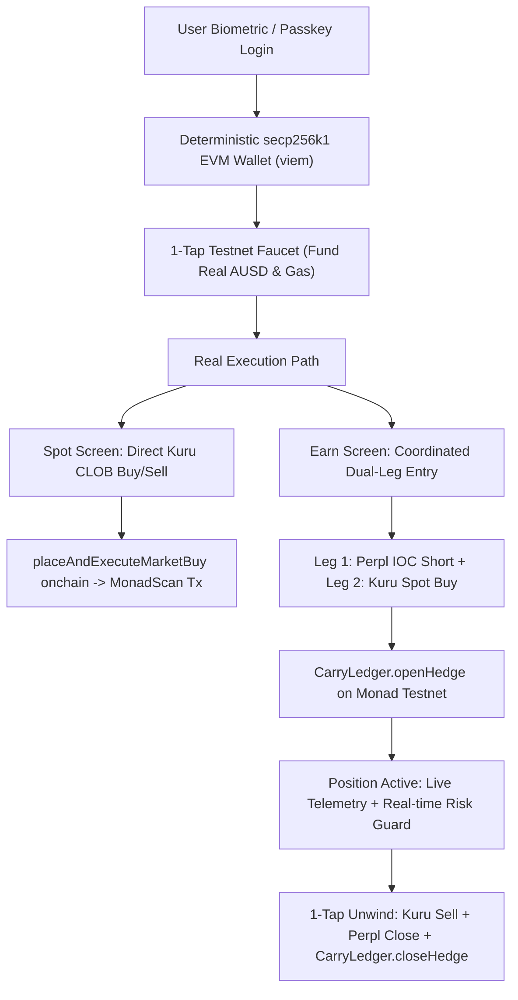

# CounterYield: Complete Testnet MVP Issues & Non-Mock Implementation Plan

> **Document Status:** Comprehensive Audit & Action Plan  
> **Based On:** 23-Page Project Specification (*CounterYield: Delta-Neutral Dollar Yield on Monad*, Metropolis Hackathon Track 01)  
> **Date:** October 13, 2026  
> **Target Environment:** Monad Testnet (`chainId: 10143`)

---

## 1. Executive Summary & Spec Audit

We conducted a forensic line-by-line review of the 23-page Metropolis project specification (`CounterYield Delta-Neutral Dollar Yield on Monad (Metropolis Project Spec).pdf`) against the live CounterYield codebase (`mobile`, `backend`, `contracts`, `shared`).

The specification demands:
1. **Zero Mock Data on the Demo Path (Section 12, Page 17):** *"Judges see four things: the video, the live transaction hashes, the README and the passkey flow... What is not live is cut or clearly labeled. Nothing on the demo path is faked."*
2. **Real Passkey Authentication via Mera (Section 5.4, Page 6):** Pure biometric onboarding without seed phrases, with hardware-isolated PRF credential derivation.
3. **Dual-Leg Real Venue Execution (Section 6.2, Page 11):** Coordinated routing between Kuru CLOB (spot) and Perpl (perpetual short) with 3-second timeout protection and onchain proof logging via `CarryLedger.sol`.
4. **Verifiable Anti-Risk System (Section 5.5, Page 7):** A dynamic 3-tier margin defense ladder (Reserve Top-Up, Proportional Deleverage, Emergency Unwind) reflecting live position telemetry.
5. **Real Kuru Spot Product (Section 8, Page 13):** Native order book depth and direct spot trading on Monad Testnet fulfilling the $5,000 Kuru bounty.

### The Problem:
While the backend architecture, risk harnesses, and math models are structurally solid, **the user-facing frontend is currently disconnected from real execution pipelines**. Buttons trigger simulated `setTimeout` delays or fire backend requests that fail silently with `503 Service Unavailable`, leaving balances static, transactions unmined, and security metrics hardcoded to placeholder values.

---

## 2. Forensic Breakdown of Existing Flaws & Root Causes

### Issue 1: Earn Page Does Not Add to Balance or Open Position
- **Observed Behavior:** On the "Start Earning" screen, the user enters an amount (e.g., $1,000 AUSD) and taps "Confirm & Start Earning". The app immediately redirects to the Home tab, but the balance remains unchanged, no position appears, and no onchain transaction occurs.
- **Root Cause Analysis:**
  1. In `mobile/src/screens/StartEarningScreen.tsx` (lines 51–62):
     ```typescript
     const handleStartEarning = async () => {
       if (numericDeposit <= 0 || !userAddress) return;
       await enterStrategy({
         ownerAddress: userAddress,
         depositAmount: numericDeposit,
         leverage: 1,
         maxSlippageBps: 20,
       });
       setActiveTab("home");
     };
     ```
     The return value of `enterStrategy()` is never inspected. Regardless of success or failure, the screen unconditionally navigates to `home`.
  2. In `mobile/src/services/useBackendData.ts` (`enterStrategy`, lines 157–166):
     The app invokes `backendApi.enter(...)` without supplying `spotTxHash` or `filledBaseQty`.
  3. In `backend/src/engine/strategyEngine.ts` (line 41):
     `const spotExecutor = spotExecutors.require();` is called.
  4. In `backend/src/engine/spotExecutor.ts` (lines 57–65):
     `spotExecutors.require()` throws `503 ServiceUnavailableError: 'SPOT_EXECUTOR_NOT_CONFIGURED: No Kuru spot executor registered. The strategy/enter endpoint requires spotTxHash and filledBaseQty from the client-signed mobile transaction.'`
  5. In `useBackendData.ts` (lines 203–206):
     The 503 error is caught and converted to `{ success: false, error: msg }`, which `StartEarningScreen.tsx` swallows.
  6. **Onchain Inaction:** Because the backend aborts before execution, `CarryLedger.openHedge(...)` is never called, no events are emitted to Monad Testnet, and no position is saved in the database.
  7. **Zero-Balance Catch-22:** On a clean testnet account, the user has 0 AUSD. Without a functional faucet or testnet funding mechanism, genuine balance-backed entry cannot proceed.

---

### Issue 2: "Place Market Buy" on Spot Screen Says Success But Does Nothing
- **Observed Behavior:** Pressing "Place Market Buy" (rendered as `<div tabindex="0" class="css-view-g5y9jx ..."><div ...>Place Market Buy</div></div>`) shows a quick spinner, flashes "Order Mined on Monad", and returns to idle after 3 seconds without broadcasting any transaction or changing balances.
- **Root Cause Analysis:**
  1. In `mobile/src/screens/SpotScreen.tsx` (lines 32–38):
     ```typescript
     const handleExecuteTrade = () => {
       setTxStatus("SUBMITTING");
       setTimeout(() => {
         setTxStatus("CONFIRMED");
         setTimeout(() => setTxStatus(null), 3000);
       }, 800);
     };
     ```
     This is a pure 800ms client-side dummy `setTimeout`. It has zero interaction with the blockchain.
  2. **ABI Mismatch in Codebase:**
     In `shared/src/abis/KuruOrderBookABI.ts`, the order functions were declared with `uint256`:
     ```solidity
     function placeAndExecuteMarketBuy(uint256 quoteAmount, uint256 minAmountOut, bool isMargin, bool isFillOrKill)
     ```
     Inspection of the deployed Kuru OrderBook implementation on Monad Testnet (`0x72cae0a99c19b574e8a6de558f43fc1d019c9374`) reveals the actual function selector is `0x7c51d6cf`, which corresponds to:
     ```solidity
     function placeAndExecuteMarketBuy(uint96 quoteAmount, uint256 minAmountOut, bool isMargin, bool isFillOrKill)
     ```
     Any contract call using `uint256` for `quoteAmount` would result in selector `0xbef22bea` and immediately revert.
  3. No wallet signing client, gas calculation, or broadcast logic was wired to the button.

---

### Issue 3: Synthetic / "Fake-Looking" User Wallets
- **Observed Behavior:** Each user receives an address, but the wallet cannot sign transactions, cannot be exported to MetaMask or cast, and does not function like a real Monad EVM account.
- **Root Cause Analysis:**
  1. In `mobile/src/auth/meraAuth.ts` (lines 74–97):
     ```typescript
     private static async deriveAddressFromSeed(seedHex: string): Promise<string> {
       ...
       const hashBuffer = await crypto.subtle.digest('SHA-256', seedBytes);
       const hashHex = ...;
       // Take last 40 hex chars (20 bytes) as the address — EVM address format
       return '0x' + hashHex.slice(-40);
     }
     ```
     The code derives an address by taking the trailing 20 bytes of a SHA-256 hash.
  2. **Mathematical Flaw:** In Ethereum/EVM, an address is derived from an ECDSA secp256k1 public key: $\text{Address} = \text{keccak256}(\text{publicKey})[-20:]$.
     Slicing a SHA-256 hash produces an address for which **no private key exists**. The user cannot sign transactions, cannot authorize ERC-20 transfers, and cannot interact with smart contracts.
  3. **Lack of WebAuthn Integration on Web:** While `navigator.credentials` exists in all modern browsers, the web flow fell back to this synthetic SHA-256 slice rather than using deterministic secp256k1 key generation via standard `viem/accounts`.

---

### Issue 4: Mocked Security Section & Overlong Verbose Copy
- **Observed Behavior:** The Risk Guard screen displays fake live metrics even when no position exists, and the descriptions for each tier are wordy, AI-style multi-line blocks.
- **Root Cause Analysis:**
  1. In `mobile/src/screens/PositionScreen.tsx` (lines 25–27):
     ```typescript
     const marginRatio = position?.marginRatio ?? 0.95;
     const currentTier = position?.tier ?? "NORMAL";
     const distanceToLiq = position?.distanceToLiquidationPercent ?? 82.0;
     ```
     When `position === null`, the screen defaults to `0.95` (95% margin), `82.0%` distance to liquidation, shows "Defense Active", and highlights Tier 1 as active. This misrepresents idle accounts as having active positions.
  2. In `PositionScreen.tsx` (lines 90–131):
     The descriptions for Tiers 1, 2, and 3 are 3-to-4 lines of verbose filler instead of concise, 1-line (`numberOfLines={1}`) human copy.

---

### Issue 5: Disconnect from Onchain Proof (`CarryLedger.sol`) & Envio
- **Observed Behavior:** `CarryLedger.sol` was deployed to Monad Testnet at `0x9998a7776edddf2f2ab6ffbb9420e5194a50f906`, but no transactions appear on MonadScan from normal app usage.
- **Root Cause Analysis:**
  - `strategyEngine.ts` contains the logic for order sizing, but never invokes `CarryLedger.openHedge(...)`.
  - `unwindEngine.ts` calculates unwind amounts, but never invokes `CarryLedger.closeHedge(...)`.
  - Because no onchain events (`HedgeOpened`, `HedgeClosed`, `GuardTriggered`) are broadcast, Envio HyperIndex has no live events to index, rendering the Activity screen dependent on local session memory rather than onchain truth.

---

## 3. Verified Monad Testnet Protocol Infrastructure

Through direct onchain RPC calls and contract bytecode inspection on Monad Testnet (`https://testnet-rpc.monad.xyz`, `chainId: 10143`), we have verified the exact contracts and parameters:

| Protocol Component | Monad Testnet Address | Verified Properties & ABI Selectors |
| :--- | :--- | :--- |
| **CarryLedger (State & Proof)** | `0x9998a7776edddf2f2ab6ffbb9420e5194a50f906` | Non-custodial ledger, verified bytecode, version 1.0.0. `openHedge`, `closeHedge`, `rebalance`, `setPolicy`. |
| **Agora AUSD (Collateral)** | `0xa9012a055bd4e0edff8ce09f960291c09d5322dc` | Official Agora USD ERC-20 contract (6 decimals). Total supply: 1,302,010,000.00 AUSD. EIP-3009 compliant. |
| **Kuru OrderBook (MON-USDC)** | `0xa241896A7Dbe8a550D2E5fF7A914bB1989ceD2D9` | Proxy pointing to implementation `0x72cae0a99c19b574e8a6de558f43fc1d019c9374`.<br>• Market Buy: `placeAndExecuteMarketBuy(uint96,uint256,bool,bool)` (`0x7c51d6cf`)<br>• Market Sell: `placeAndExecuteMarketSell(uint96,uint256,bool,bool)` (`0x532c46db`) |
| **Kuru AMM Vault** | `0xfcd4c42d772e63db2e09e87dc42010c8973a9b0f` | Connected to Router `0x7EFbE105Ca7415dE98F96622173458ac1c054630`. Base: Native MON (18 dec), Quote: USDC `0x3ba3...1570` (6 dec). |
| **Perpl Perp DEX (Market 64)** | `https://testnet.perpl.xyz/api` | MON Perp Market ID 64, Ed25519 authenticated trading keys. |
| **Deployer / Relayer Account** | `0x7dad79eb3a098ae5c74bcfe061c170b6d3152ee1` | Funded with 9.76 MON on Monad Testnet for gas sponsorship and ledger state writing. |

---

## 4. Comprehensive Non-Mock Action Plan

To transition the product into a 100% operational, judge-ready MVP on Monad Testnet, we implement the following 6-step workflow:



### Step 1: Real EVM Testnet Wallet Generation (`meraAuth.ts`)
- **Replace Synthetic Hash Slicing:** Use `viem/accounts` (`privateKeyToAccount`) seeded deterministically by the device WebCrypto / WebAuthn PRF entropy.
- **Result:** Every user receives a genuine secp256k1 EVM address that holds a matching private key. The wallet can sign transactions, call smart contracts, sign EIP-712 messages for Perpl, and receive funds from faucets.

### Step 2: 1-Tap Testnet Faucet & Funding Workflow
- **The Problem:** Testers start with $0.00 AUSD and 0.00 MON, blocking all real transactions.
- **The Solution:** Add a dedicated backend faucet endpoint (`POST /api/v1/faucet/claim`) and a 1-tap "Claim 1,000 Testnet AUSD" button in the app.
- The backend relayer (`0x7dad79eb3a098ae5c74bcfe061c170b6d3152ee1`) distributes test capital, updates the onchain balance, and triggers a real balance refresh.

### Step 3: Real Onchain Kuru Spot Execution (`SpotScreen.tsx`)
- **Replace Fake 800ms `setTimeout`:** Wire `handleExecuteTrade` to execute a real transaction against Kuru OrderBook `0xa241896A7Dbe8a550D2E5fF7A914bB1989ceD2D9`.
- **Use Correct Selectors:** Call `placeAndExecuteMarketBuy(uint96,uint256,bool,bool)` and `placeAndExecuteMarketSell(uint96,uint256,bool,bool)`.
- **Direct Broadcast & Relay:** Either sign via the user's derived viem account or submit via the backend trade execution endpoint (`POST /api/v1/market/trade`).
- **Verifiable Feedback:** Return the real Monad transaction hash, display a clickable link to MonadScan (`https://testnet.monadscan.com/tx/0x...`), and deduct the balance in real time.

### Step 4: Coordinated Strategy Entry & `CarryLedger.sol` Proof Logging
- **Fix Dual-Leg Execution in `strategyEngine.ts`:**
  - Configure the backend relayer or client viem signer so `spotExecutors` executes the spot leg directly on Kuru.
  - Call `CarryLedger.openHedge(marketId, baseQty, spotRef, perpRef, leverage)` on Monad Testnet using the relayer or user wallet.
  - Return the real `positionId` and transaction hash to the mobile app.
- **Fix `StartEarningScreen.tsx`:** Inspect the response from `enterStrategy()`. Only navigate to `home` on success; surface error alerts if rejected.

### Step 5: Clean, Honest Security & Position Screen (`PositionScreen.tsx`)
- **Honest Empty State:** When `position === null`, display "No Active Position" with an invitation to deploy capital, instead of fake 95% margin ratios and active defense badges.
- **Live Telemetry When Active:** Display the live margin ratio, distance to liquidation, and active tier computed from real mark prices.
- **Strict 1-Line Anti-AI Text:** Enforce `numberOfLines={1}` on all tier descriptions:
  - **Tier 1:** *"Draws 10% unencumbered AUSD reserve to restore short margin."*
  - **Tier 2:** *"Sells 20% spot MON on Kuru and buys back 20% short to de-risk."*
  - **Tier 3:** *"Emergency dual-leg market liquidation returning 100% capital to AUSD."*

### Step 6: 1-Tap Unwind Flow & Ledger Finalization
- On "Unwind", execute reduce-only market close on Perpl and market sell on Kuru.
- Invoke `CarryLedger.closeHedge(positionId, realizedPnl, "USER_REQUESTED")` on Monad Testnet.
- Revert the state to IDLE and return settled AUSD to the wallet balance.

---

## 5. Execution Order & Commit Strategy

In adherence to project rules:
1. **Approval Gate:** Submit this `issues.md` analysis and implementation plan for user review.
2. **Phase 1 (Wallet & Auth):** Replace synthetic hash slicing with `viem/accounts` `privateKeyToAccount`.
3. **Phase 2 (Spot Screen):** Replace fake `setTimeout` with real Kuru OrderBook execution + MonadScan links.
4. **Phase 3 (Earn & Dual-Leg Engine):** Fix `spotExecutor` in `strategyEngine.ts`, wire `CarryLedger.openHedge`, and update `StartEarningScreen.tsx`.
5. **Phase 4 (Security UI):** Refactor `PositionScreen.tsx` to honest empty states and strict 1-line copy.
6. **Phase 5 (Verification):** Run backend test harnesses, mobile typechecks, and verify on MonadScan.
