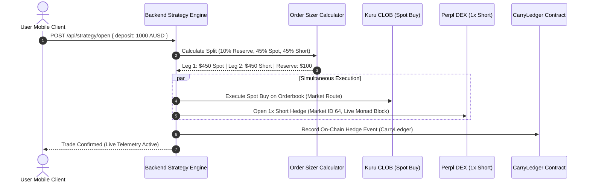

[<- Back to README](../README.md)

# Update 1: Dual-Leg Execution Engine Across Kuru and Perpl

**One-tap simultaneous execution that pairs spot MON purchases on Kuru CLOB with 1x short hedges on Perpl DEX.**

 

  
  
  
  

---

## Overview

> [!NOTE]
> CounterYield tries to earn money from the funding fees paid by crypto traders, without betting on whether MON goes up or down.

1. You deposit AUSD.
2. 10% stays as a safety reserve.
3. The app buys MON on Kuru.
4. At the same time, it shorts the same amount of MON on Perpl.
5. If MON goes up, the spot position gains while the short loses.
6. If MON goes down, the spot position loses while the short gains.

So the two positions roughly cancel each other out, meaning you're mainly trying to earn the funding payments.

> [!TIP]
> **In simple terms:**  
> Buy MON + short the same MON amount = price movement mostly cancels out -> collect funding fees.

---

## Why This Engine Was Built

Executing this trade by hand involves significant friction and market risk:
- Managing two separate exchange platforms and manually calculating equivalent position sizes.
- Execution delay between legs leaves you exposed to rapid price fluctuations before the hedge is set.
- Constant manual monitoring is required to ensure collateral levels remain safe against liquidation.

This dual-leg execution engine opens both sides simultaneously in a single tap while maintaining a dedicated 10% cash reserve.

---

## Execution Flow

---

## How the Two Legs Work Together

When you initiate a deposit, the engine coordinates the following sequence:

1. **Spot Buy on Kuru**:
   - The app routes spot MON acquisition directly through Kuru's on-chain central limit orderbook router (`0x7EFbE105Ca7415dE98F96622173458ac1c054630`).
   - Orders are signed directly by your client key.

2. **Perpetual Short on Perpl**:
   - Concurrently, the engine submits a 1x short hedge order on Perpl Market ID 64.
   - Dynamic block height queries on Monad ensure order time-to-live parameters align with current testnet block numbers (~block 70M).

3. **10% Safety Buffer Allocation**:
   - 10% of total deposited funds are retained as unencumbered AUSD collateral.
   - The remaining 90% is divided symmetrically: 45% spot purchase and 45% short margin backing.

4. **1-Tap Unwind**:
   - Tapping Unwind triggers symmetric position closure: the Perpl short is bought back, the Kuru spot holding is sold, and 100% of proceeds return to your wallet as AUSD.

---

## Relevant Files and Folders in the Repository

| File / Folder | Role & Implementation Responsibility |
| :--- | :--- |
| [`backend/src/engine/strategyEngine.ts`](../backend/src/engine/strategyEngine.ts) | Coordinates the dual-leg trade workflow and enforces balance pre-checks. |
| [`backend/src/engine/spotExecutor.ts`](../backend/src/engine/spotExecutor.ts) | Bridges client-signed Kuru spot orders into backend execution pipelines. |
| [`backend/src/clients/kuruClient.ts`](../backend/src/clients/kuruClient.ts) | Interfaces with Kuru smart contracts on Monad to fetch live books and submit orders. |
| [`backend/src/clients/perplClient.ts`](../backend/src/clients/perplClient.ts) | Sends orders to Perpl DEX with live Monad block validation. |
| [`backend/src/api/routes/strategyRoutes.ts`](../backend/src/api/routes/strategyRoutes.ts) | API endpoints for trade quotation, execution initiation, and position unwinding. |
| [`shared/src/calculators/OrderSizer.ts`](../shared/src/calculators/OrderSizer.ts) | Sizing algorithm enforcing the 10% reserve split and symmetric 45/45 leg sizing. |
| [`shared/src/calculators/BreakEvenCalculator.ts`](../shared/src/calculators/BreakEvenCalculator.ts) | Calculates operational fee amortization against live funding fee rates. |
| [`backend/src/test/engine.test.ts`](../backend/src/test/engine.test.ts) | Automated unit and integration test suite verifying dual-leg mechanics. |
