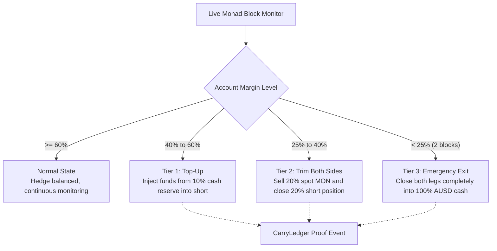

[<- Back to README](../README.md)

# Update 2: Automated 3-Tier Risk Guard and Deployed On-Chain CarryLedger

<strong>Autonomous multi-tier margin protection engine paired with an audited on-chain proof ledger on Monad testnet.</strong>

  
  
  
  

---

## Overview

> [!NOTE]
> CounterYield tries to earn money from the funding fees paid by crypto traders, without betting on whether MON goes up or down.

1. You deposit AUSD.
2. 10% stays as a safety reserve.
3. The app buys MON on Kuru.
4. At the same time, it shorts the same amount of MON on Perpl.
5. If MON goes up, the spot position gains while the short loses.
6. If MON goes down, the spot position loses while the short gains.

So the two positions roughly cancel each other out, meaning you're mainly trying to earn the funding payments.

> [!TIP]
> **In simple terms:**  
> Buy MON + short the same MON amount = price movement mostly cancels out -> collect funding fees.

---

## The Risk Challenge

When holding equal spot and short positions:
- If MON price declines, the short gains value while spot loses value; they cancel out cleanly.
- If MON price surges rapidly, spot gains value, but the short position consumes margin collateral to avoid exchange liquidation.
- Without autonomous monitoring, a sudden rally could lead to exchange-level liquidation penalties, leaving an unhedged spot position.

---

## Automated 3-Tier Defense Engine

The Risk Guard monitors position health on every single Monad block, taking automated preventive action:

### Defense Tiers in Detail

1. **Tier 1 (Top-Up)**:
   - When margin level enters 40% to 60%, unencumbered cash from the 10% reserve is transferred to the short margin balance.
   - Positions remain 100% open with zero asset sales required.

2. **Tier 2 (Trim Both Sides)**:
   - If the 10% reserve is fully deployed and margin drops between 25% and 40%, the engine executes a symmetric 20% reduction: selling 20% of spot MON and buying back 20% of the short.
   - This frees collateral and resets the margin ratio above 100%.

3. **Tier 3 (Emergency Exit)**:
   - If margin drops below 25% for two consecutive blocks, both positions are immediately unwound into 100% AUSD cash.
   - Liquidation by external DEX liquidators is prevented, preserving user principal.

---

## On-Chain CarryLedger Audit Contract

The non-custodial audit contract [`CarryLedger.sol`](../contracts/src/CarryLedger.sol) is live on Monad Testnet:

- **Contract Address**: [`0x9998a7776edddf2f2ab6ffbb9420e5194a50f906`](https://testnet.monadscan.com/address/0x9998a7776edddf2f2ab6ffbb9420e5194a50f906)
- **Deployment Transaction**: [`0x3e49fe3afaf6a3a03d9bd310c71ec5a2f22758ea2f7ebb07baaff28f40b780b1`](https://testnet.monadscan.com/tx/0x3e49fe3afaf6a3a03d9bd310c71ec5a2f22758ea2f7ebb07baaff28f40b780b1)
- **Non-Custodial Architecture**: The contract holds zero user funds; assets remain strictly in user wallets and DEX margin accounts.
- **Auditable Event Proofs**: Open, rebalance, trim, and unwind events emit cryptographic events on Monad.
- **Envio Indexer Integration**: Envio HyperIndex captures contract events for sub-second GraphQL retrieval.

---

## Relevant Files and Folders in the Repository

| File / Folder | Role & Implementation Responsibility |
| :--- | :--- |
| [`contracts/src/CarryLedger.sol`](../contracts/src/CarryLedger.sol) | Solidity smart contract deployed on Monad for on-chain audit tracking. |
| [`contracts/test/CarryLedger.t.sol`](../contracts/test/CarryLedger.t.sol) | Foundry test suite confirming non-custodial boundaries and policy limits. |
| [`contracts/script/GasBenchmark.s.sol`](../contracts/script/GasBenchmark.s.sol) | Gas profiling script confirming ~357k gas deployment cost on Monad. |
| [`backend/src/engine/riskEngine.ts`](../backend/src/engine/riskEngine.ts) | Mathematical evaluation engine managing the 3 margin defense tiers. |
| [`backend/src/engine/unwindEngine.ts`](../backend/src/engine/unwindEngine.ts) | Closes both spot and short legs simultaneously into AUSD cash. |
| [`backend/src/risk/riskDaemon.ts`](../backend/src/risk/riskDaemon.ts) | Autonomous background service executing per-block position monitoring. |
| [`backend/src/test/stressHarness.test.ts`](../backend/src/test/stressHarness.test.ts) | Stress tests simulating +25%, +45%, and +65% market shock events. |
| [`indexer/config.yaml`](../indexer/config.yaml) | Envio HyperIndex configuration binding Monad testnet chain ID 10143. |
| [`indexer/schema.graphql`](../indexer/schema.graphql) | GraphQL schema defining on-chain hedge and rebalance entities. |
| [`indexer/src/EventHandlers.ts`](../indexer/src/EventHandlers.ts) | Real-time event ingestion handlers for CarryLedger on-chain events. |
