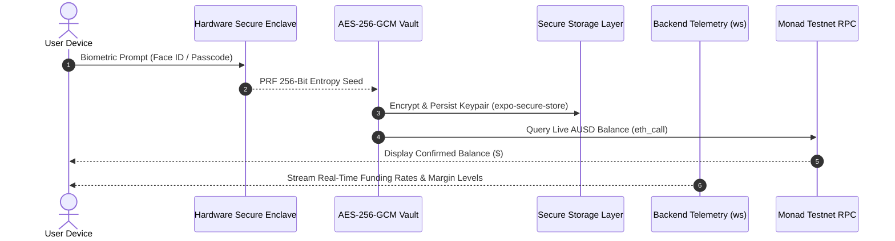

[<- Back to README](../README.md)

# Update 3: Seedless Biometric Mobile Client and Live Telemetry Architecture

**Consumer-grade mobile interface with hardware Secure Enclave biometric login, zero seed phrases, and real-time Monad feeds.**

 

  
  
  
  

---

## Overview

> [!NOTE]
> CounterYield tries to earn money from the funding fees paid by crypto traders, without betting on whether MON goes up or down.

1. You deposit AUSD.
2. 10% stays as a safety reserve.
3. The app buys MON on Kuru.
4. At the same time, it shorts the same amount of MON on Perpl.
5. If MON goes up, the spot position gains while the short loses.
6. If MON goes down, the spot position loses while the short gains.

So the two positions roughly cancel each other out, meaning you're mainly trying to earn the funding payments.

> [!TIP]
> **In simple terms:**  
> Buy MON + short the same MON amount = price movement mostly cancels out -> collect funding fees.

---

## The User Experience Problem

Traditional decentralized finance applications introduce severe onboarding friction:
- Requiring users to write down 12-word seed phrases on physical paper.
- Requiring third-party browser extensions with confusing hex transaction approvals.
- High risk of permanent loss if paper backups are misplaced.

CounterYield adopts a modern consumer banking experience: sign in using Face ID, Touch ID, or device passcodes without seed phrase management.

---

## Biometric Vault & Telemetry Architecture

---

## Core Mobile Capabilities

1. **Hardware-Isolated Key Derivation**:
   - The client invokes the device's hardware security chip (Secure Enclave) using WebAuthn PRF.
   - Authentication works seamlessly across Face ID on iOS, fingerprint authentication on Android, and passcode unlock on Web/Desktop.

2. **Zero Seed Phrase Exposure**:
   - Trading keys are encrypted via authenticated AES-256-GCM and stored locally (`expo-secure-store` on native platforms, `localStorage` on web browsers).
   - Private keys are never transmitted to external servers or cloud storage.

3. **Live On-Chain Data Streams**:
   - **Real AUSD Balances**: Live `eth_call` balance queries execute against the canonical Agora AUSD contract on Monad.
   - **Real-Time Telemetry**: Persistent WebSocket connection streams live mark prices, current margin ratios, and accrued funding yield every second.
   - **Kuru Spot Orderbook**: A dedicated Spot screen displays live resting bids and asks directly from Kuru's Monad orderbook.
   - **Vector Asset Logos**: Custom vector illustrations for Kuru, Perpl, Monad, and Agora ensure instant visual clarity for each leg of the trade.

---

## Relevant Files and Folders in the Repository

| File / Folder | Role & Implementation Responsibility |
| :--- | :--- |
| [`mobile/src/auth/meraAuth.ts`](../mobile/src/auth/meraAuth.ts) | Inspects device biometric capabilities and derives the unique Monad account address. |
| [`mobile/src/auth/prfVault.ts`](../mobile/src/auth/prfVault.ts) | Manages Web Crypto subtle AES-256-GCM hardware key encryption and decryption. |
| [`mobile/src/components/Logos.tsx`](../mobile/src/components/Logos.tsx) | Authentic vector icon components for Kuru, Perpl, Monad, and Agora. |
| [`mobile/src/screens/WelcomeScreen.tsx`](../mobile/src/screens/WelcomeScreen.tsx) | 3-step onboarding flow explaining market neutrality, venue distribution, and biometrics. |
| [`mobile/src/screens/HomeScreen.tsx`](../mobile/src/screens/HomeScreen.tsx) | Main dashboard presenting active balances, live yield, and dual-leg position statuses. |
| [`mobile/src/screens/StartEarningScreen.tsx`](../mobile/src/screens/StartEarningScreen.tsx) | Deposit interface allowing 1-tap position entry with automatic 10% reserve sizing. |
| [`mobile/src/screens/SpotScreen.tsx`](../mobile/src/screens/SpotScreen.tsx) | Live orderbook interface displaying bid/ask depth from Kuru on Monad. |
| [`mobile/src/screens/ActivityScreen.tsx`](../mobile/src/screens/ActivityScreen.tsx) | Historical trade log with direct links to transactions on Monadscan. |
| [`mobile/src/services/useTelemetry.ts`](../mobile/src/services/useTelemetry.ts) | WebSocket hook maintaining real-time telemetry with exponential backoff reconnects. |
| [`mobile/src/state/store.ts`](../mobile/src/state/store.ts) | Centralized state store managing user balances, active trades, and auth states. |
| [`mobile/src/theme.ts`](../mobile/src/theme.ts) | Spore Dark theme tokens featuring matte charcoal (`#131313`) and lime (`#9FE825`). |
